# Codebase Mentor — Consolidated Product Features & Implementation Blueprint

**Project:** Codebase Mentor / Living Code Journeys — CODE APEX 3.0, iMocha AI Onboarding for Developers
**Document date:** 24 October 2026
**Document type:** Master scope, feature catalogue, implementation roadmap, and evidence-boundary audit
**Status:** A combination of existing code, bounded prototypes, and accepted/proposed work. **This document does not claim that future features are implemented or verified.**

> **Mission:** Help a new developer understand an unfamiliar *real repository*, explain how its features work with checkable source citations, make a meaningful first contribution, get precise help when blocked, and retain useful understanding when code or work context changes.

## TL;DR — Every feature at a glance

**Total catalogue: 17 numbered feature areas.** This is the original **13** documented features plus **Runtime X-Ray**, **Smart Context Handoff**, **Work Context Time Machine**, and the **Agent Context Bridge** already visible in the uploaded application. **Living Decision & Failure Memory is an accepted expansion of original Feature 7—not an extra duplicate.** The PR Merge Simulator and real-code Mentor Workspace are also retained as supporting product capabilities within the relevant features/platform.

| ID | Feature | One-line purpose | Source-review status |
|---|---|---|---|
| F01 | Evidence-backed Q&A | Ask about code and open exact commit-pinned file/line evidence. | Real backend path; optional LLM-dependent |
| F02 | Interactive Architecture Atlas | Explore components, relations, routes and source evidence. | Real backend + UI, bounded analysis |
| F03 | Guided Code Journeys | Follow a reviewed feature path and branch logic step by step. | Connected curated demo; general live-path integration pending |
| F04 | Goal-based Onboarding | Teach the repository concepts needed for a developer's task. | Curated demo/rules; live repository integration pending |
| F05 | Predict, Explain, Verify | Test understanding of branch outcomes and supporting source. | Curated demo checks; wider live assessment pending |
| F06 | First-contribution Practice | Safely attempt a code change, receive hints, and verify results. | Local demo Zod assertions; no arbitrary repository execution |
| F07 | Living Decision & Failure Memory | Preserve approved design reasons and lessons from failures. | Draft/discussion paths + demo approval; production workflow pending |
| F08 | PR Impact & Journey Diff | Compare real commits/PRs, graph impact and changed paths. | Real PR analysis, diffs, local merge preview; deeper verification pending |
| F09 | Learning Drift & Targeted Relearning | Flag only lessons whose supporting code may be stale. | Demonstrated with fixtures; full live coupling pending |
| F10 | Understanding & Peer Evaluation | Track evidence of learning and run an honest peer comparison. | Local progress/demo events; real study pending |
| F11 | Setup Drift Guard | Detect version-specific setup changes and propose updates. | Static/manifest analysis; executed setup checks pending |
| F12 | Voice-guided Code Mentor | Ask/spoken explanations linked to repository source. | Voice-enabled component discussion paths; full agent integration not established |
| F13 | Living Repository Documentation | Generate source-linked, versioned documentation. | Real repository docs and optional model-generated guides |
| F14 | Runtime X-Ray Mentor / Code Theater | Animated source/trace timeline with adaptive visual teaching. | **Planned / discussed**; no real runtime trace in uploaded code |
| F15 | Smart Context Handoff | Share an exact coding question and prepared evidence with a senior. | **Accepted new feature; not implemented** |
| F16 | Work Context Time Machine | Save and accurately resume a developer's task context. | **Accepted new feature; not implemented** |
| F17 | Agent Context Bridge & optional MCP extension | Export scoped source context to external coding agents. | Manual fixture export exists; live export / MCP service not established |

**Accepted enhancement to F07:** Living Decision & Failure Memory adds incident/failure lessons, source-linked rationale, maintainer approval, and review when supporting code changes. It **does not** create a new numbered feature.

**No accidental scope additions:** Previous brainstorms—CI Failure Courier, Requirement Reality Check, Review-to-Learning Loop, Expert Finder, PR Review Briefing Room, Shadow-a-PR Mentor, API Contract Handshake, Change Collision Radar, Knowledge Risk Radar, Verified First-PR Studio, Change Contract Guardian, Real Bug Replay Lab, and Environment Rescue Doctor—are **not committed here as independent features**. Selected concepts already within F06/F07/F08/F15 may inform implementations, but they are not silently added to the contracted 17-feature list. *Runtime X-Ray is retained as a discussed addition because its design was developed directly in this conversation; it remains proposed rather than certified as delivered.*

## Problem-statement alignment and non-goals

This project specifically answers the **iMocha Codebase Mentor: AI Onboarding for Developers** problem for interns, newcomers, open-source contributors, and engineering teams.

| Challenge requirement | Features that directly address it | Evidence required |
|---|---|---|
| Architecture overview | F02, F13 | Correct source-linked components and typed relationships |
| Guided tours of key flows | F03; optional advanced F14 | Supported flow steps, branches, and source references |
| How/why Q&A with exact files and lines | F01, F07, F12 | Claim-level evidence and documented intent where available |
| Suggested starter tasks / first contribution | F04, F06 | Relevant task brief and honestly reported verification |
| Documentation stays updated as code changes (optional) | F08, F09, F11, F13 | Immutable versions, dependencies and explicit staleness |
| Works on a real open-source repository | Shared analysis foundation | Real pinned repository commit, not only synthetic demo |
| Small peer test shows impact | F10 | Collected observations; never invented results |
| Better collaboration and continuity (selected enhancements) | F07, F15, F16, F17 | Authorized access, source provenance and user-reviewed context |

**Stage expectations:** Stage 1 explains the concept and grounding; Stage 2 proves cited Q&A and architecture on one real repository; Stage 3 adds tours, starter tasks, updates, and a small real user study. Advanced features should support—not displace—these required deliverables.

**Explicit non-goals for the first release:** support for every programming language/framework; guaranteed full control-flow recovery; executing untrusted repository scripts on the host; autonomous unrestricted code pushes/merges; a public private-code sharing service; a proven reduction in onboarding time before the peer study; and AI-authored historical intent presented as fact.

## Current-code audit — what the uploaded ZIP actually establishes

**Audited inputs:** `insomnia-code-apex_3.0-main(2).zip` and `Codebase_Mentor_Complete_Implementation_Guide(2).md`, plus the original project specification included under `frontend/Codebase_Mentor_Final_Project_Specification.md` inside the ZIP. Conclusions below come from **source/configuration/documentation inspection**, not from running a full deployed-system acceptance test. A source module or UI does not alone prove successful real-world operation.

1. **Real repository foundation is present.** `backend/src/github.js`, `analyzer.js`, `worker.js`, `storage.js`, `documentation.js`, and `server.js` implement bounded public GitHub analysis, immutable commit identity, TypeScript/JavaScript and supported Express extraction, SQLite persistence, graph/source references, and document endpoints.
2. **Live repository workspace is present.** The `Repository` and `Workspace` routes show real analyzed files/components and source-linked information. Local code drafts can be edited/downloaded; they are **not executed or pushed** to GitHub by this workspace.
3. **Real PR comparison is present.** The `Changes` route's live PR experience and backend PR modules inspect public PR metadata/patches, base/head snapshots, source diffs and static changes. A **local merge-preview simulator** supports per-file conflict previews and export, but does **not** actually merge/push a PR or verify runtime behavior.
4. **Learning and practice demos are distinct from live repository analysis.** `Journeys`, `Learn`, `Practice`, `Knowledge`, and `Progress` include synthetic fixture content. `Practice` uses a bounded password-schema exercise with local Zod assertions, **not** a general isolated execution runner for arbitrary repository changes.
5. **Component discussion and voice paths exist.** `discussionRoutes.js`, `discussion.js`, `discussionVoice.js`, and `ComponentDiscussion.tsx` provide selected-component discussions, source-scoped answers, draft/save functionality, and optional speech/transcription via ElevenLabs API credentials. This **does not prove** a production ElevenLabs Agents session, authenticated approval, or private multi-user collaboration. A separate voice-demo component also uses prepared examples.
6. **Agent Context Bridge is present only as a manual demo export.** `AgentContext.tsx` builds JSON/prompt context from bundled synthetic revisions for copying/downloading. It is **not** evidence that an MCP server/plugin, external coding agent tool execution, or live export for arbitrary analyzed repositories exists.
7. **Important absent boundaries:** the root README explicitly documents no runtime tracing, arbitrary repository execution, multi-user auth/authorization, and cross-user access control in the current local implementation. These are prerequisites for secure Runtime X-Ray observed replay and Smart Context Handoff.

**Status interpretation:** `Present` means a path/UI/source implementation exists; `Demo` means curated or simulated behavior; `Planned` means a target design not established by the ZIP; `Verified` is reserved for an explicit execution, test, or other recorded measurement. Do not convert presence into verification.

## Feature map and ownership

- **Understand:** F01 Q&A, F02 Atlas, F03 Journeys, F12 Voice, F13 Docs, F14 Runtime X-Ray.
- **Learn and contribute:** F04 Goal Route, F05 Predictions, F06 Practice, F10 Progress.
- **Capture expertise and collaborate:** F07 Decision/Failure Memory, F15 Smart Handoff, F17 Agent Context Bridge.
- **Keep context correct over time:** F08 PR Comparison, F09 Learning Drift, F11 Setup Drift, F16 Context Time Machine.
- **Supporting surfaces (not separate numbered feature areas):** real-repository Mentor Workspace; source/code inspector; locally edited/downloadable drafts; PR Merge Simulator; component-level discussion; repository analysis progress/capability report; per-commit source links.

---

# Part I — Original features and accepted F07 enhancement

The next 13 features are retained from the supplied implementation guide, with F07 explicitly expanded. They describe **target contracts**, not certification that every step is already live. The shared foundation is intentionally reused by every added feature.

## 1. Shared technology and analysis foundation

### 1.1 Technology choices

Use the stack from the submitted presentation as the starting point. React Flow, SQLite FTS5, runtime schema validation, and the ElevenLabs integration make the proposed implementation more concrete.

| Layer | Technology | Simple responsibility |
| --- | --- | --- |
| Frontend | React, TypeScript, Vite | Display the workspace and handle interactions. |
| Styling | Tailwind CSS | Keep layouts and the existing visual theme consistent. |
| Graph interface | React Flow | Display clickable components and their connections. |
| Animation | React state; optional GSAP | Highlight the current step. Animation does not analyse code. |
| Backend | Node.js, Express, TypeScript | Handle requests and coordinate feature modules. |
| Background analysis | One Node.js worker with a persistent jobs table | Process repository analysis without holding an HTTP request open. |
| Source analysis | TypeScript Compiler API | Extract declarations, source locations, and supported symbol relationships. |
| Storage | SQLite and versioned JSON | Store source references, graphs, lessons, checks, and progress. |
| Retrieval | SQLite FTS5, symbol search, graph neighbours | Find code relevant to a question. |
| AI explanation | Configurable LLM provider adapter | Explain retrieved facts and draft structured content. |
| Voice | ElevenLabs Agents and its React SDK | Support spoken questions and responses. |
| Versions | Git commits; GitHub API when needed | Identify exact source versions and compare changes. |
| Validation | Runtime schemas, for example Zod | Reject malformed model output and invalid tool arguments. |
| Execution | Isolated Docker worker | Run explicitly approved exercise/test recipes with limits. |

**Keep the first implementation small:** one backend, one analysis worker, one SQLite database, and a React frontend. Agent roles can be TypeScript modules. They do not require separate microservices.

The presentation includes a vector-store concept. For the first repository, use text/symbol search and graph traversal. Add embeddings behind the retrieval interface only if evaluation shows missing relevant results. Update presentation labels to match what is actually implemented.

### 1.2 Important terms in simple language

| Term | Meaning |
| --- | --- |
| Snapshot | The repository at one exact commit. |
| AST | A structured representation of source code, such as functions and conditions. |
| Symbol | A named code entity, such as a function, class, or variable. |
| Evidence graph | Components and relationships linked to supporting source. |
| Retrieval | Finding relevant source before asking the model to explain it. |
| Grounded answer | An answer supported by the selected repository's evidence. |
| Invalidation | Marking a saved explanation as needing review after its supporting code changes. |
| Trace | Events actually recorded during execution; different from a guessed path. |

### 1.3 Build one analysis pipeline for every feature

1. Accept a public GitHub repository URL and a revision, or an explicitly selected local repository.
2. Resolve it to an immutable commit SHA and store repository metadata.
3. Read source into a bounded workspace. Exclude dependencies, generated output, binary files, secrets, and oversized files.
4. Read TypeScript configuration without running repository scripts. Missing dependencies may reduce analysis coverage; report that limitation.
5. Extract declarations, imports, exports, supported route registrations, and supported direct calls.
6. Recognise only documented Express patterns. Preserve dynamic or unresolved relationships.
7. Store source spans and content hashes. Build components and typed edges.
8. Index source and symbols for retrieval. Attach relevant tests and documented rationale where available.
9. Generate structured explanations from this evidence. Validate references before publication.
10. Publish the snapshot and its capability report. All features read this same version.

### 1.4 Evidence rules for every feature

| Badge | What it means |
| --- | --- |
| Source-supported | The selected version's source or configuration supports the statement. |
| Test expectation | A checked-in test specifies expected behaviour; it may not have run. |
| Observed run | A command or instrumented scenario was actually executed. |
| Documented intent | A maintainer record, ADR, or discussion explains a decision. |
| Inferred | A plausible interpretation, visibly labelled. |
| Unknown | The available evidence cannot establish the answer. |

An import is not necessarily a call. A service class is not necessarily a microservice. A moving diagram marker is not a runtime trace. A valid citation proves a reference exists, not that every associated sentence is correct.

### 1.5 Shared source reference

```ts
interface SourceReference {
  id: string;
  snapshotId: string;
  commitSha: string;
  path: string;
  startLine: number;
  endLine: number;
  contentHash: string;
  symbolId?: string;
}
```

The backend builds source links from stored references:

```text
https://github.com/{owner}/{repo}/blob/{commitSha}/{path}#L{startLine}-L{endLine}
```

Never let the model invent the commit, path, or line range.

---

## 2. Feature 1 — Evidence-backed Q&A

**Meaning:** Ask questions about the repository and verify the answer against actual code.

**Example:** “Where is signup validation performed?” The answer explains the relevant handler and displays clickable source references.

**Technology:** Express, SQLite FTS5, symbol search, graph traversal, LLM adapter, runtime schemas, React.

### Diagram

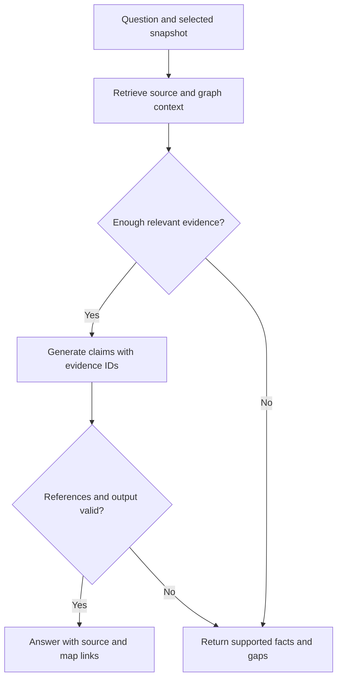

### Implementation

1. Send the question, snapshot ID, and optional selected component ID to the backend.
2. Search names and source text; expand to relevant callers, callees, or routes where supported.
3. Build a bounded context containing source excerpts and evidence IDs.
4. Ask the model for structured claims referencing only supplied IDs.
5. Check schema, snapshot identity, and reference validity. Qualify unsupported claims rather than filling gaps.
6. Render citations beside claims. Allow “Open source,” “Show on map,” and a related journey when available.

**Store/API:** `answers`, `answer_claims`, `source_refs`; `POST /api/snapshots/:id/questions`.

**Prototype:** Five manually reviewed questions on one repository, including one unanswerable question. No web search is required to answer repository-specific behaviour.

**Done when:** The citations support the answers, unknowns remain visible, and a question cannot accidentally retrieve a different snapshot.

---

## 3. Feature 2 — Interactive Architecture Atlas

**Meaning:** A map showing the main parts of the repository and how they relate.

**Example:** Click a controller to inspect its responsibility, supported service calls, and source file.

**Technology:** TypeScript Compiler API, graph JSON, React Flow, deterministic graph layout.

### Diagram

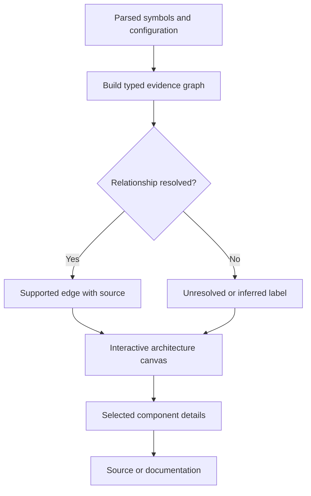

### Implementation

1. Build nodes for source-backed components, symbols, and evidenced external boundaries.
2. Keep edge types separate: imports, route registration, resolved call, possible call, and data access.
3. Group symbols into understandable components. Label model-proposed groupings as interpretation.
4. Render a small overview first, with expansion into function-level detail.
5. Add search, fit view, node selection, edge inspection, and source navigation.
6. Save user layout separately from analytical facts. Moving a node must not change a dependency.

**Store/API:** `graph_nodes`, `graph_edges`; `GET /api/snapshots/:id/graph` and `GET /api/nodes/:id`.

**Prototype:** One readable component map and one expanded feature view. Do not force every repository into controller/service/model folders.

**Done when:** Every analytical node and edge has evidence or an explicit conceptual, inferred, or unresolved label.

---

## 4. Feature 3 — Guided Code Journey Player

**Meaning:** Follow one feature step by step through the actual repository.

**Example:** Follow signup validation, user lookup, duplicate-email decision, and the supported success or failure path.

**Technology:** Evidence graph, reviewed journey JSON, React state, React Flow highlights; optional GSAP for presentation only.

### Diagram

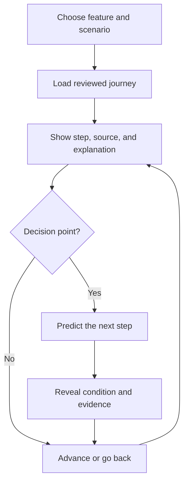

### Implementation

1. Choose a supported entry point and compose a reviewed path from extracted evidence.
2. Save ordered steps, conditions, source references, and scenario names.
3. Update the active node, source panel, and explanation together when the learner steps forward.
4. Provide start, pause, next, previous, and restart controls.
5. Include at least one failure scenario and one question at a meaningful branch.
6. Use an `explained_path` badge by default. Add `recorded_scenario` only when actual mapped execution events exist.

A passing test can demonstrate an outcome without proving every intermediate function call. Synthetic example values must be labelled as examples.

**Store/API:** `journeys`, `journey_steps`; `GET /api/snapshots/:id/journeys` and `GET /api/journeys/:id`.

**Prototype:** Two reviewed journeys on one repository; runtime instrumentation is optional later work.

**Done when:** Each step opens the right source, branch explanations are correct, and the animation makes no false execution claims.

---

## 5. Feature 4 — Goal-based Onboarding Route

**Meaning:** Teach the parts needed for the developer's intended contribution.

**Example:** Someone adding input validation studies routing, validation, and relevant tests before attempting the task.

**Technology:** React forms, prerequisite graph, SQLite learner state, rule-based lesson selection, optional LLM wording.

### Diagram

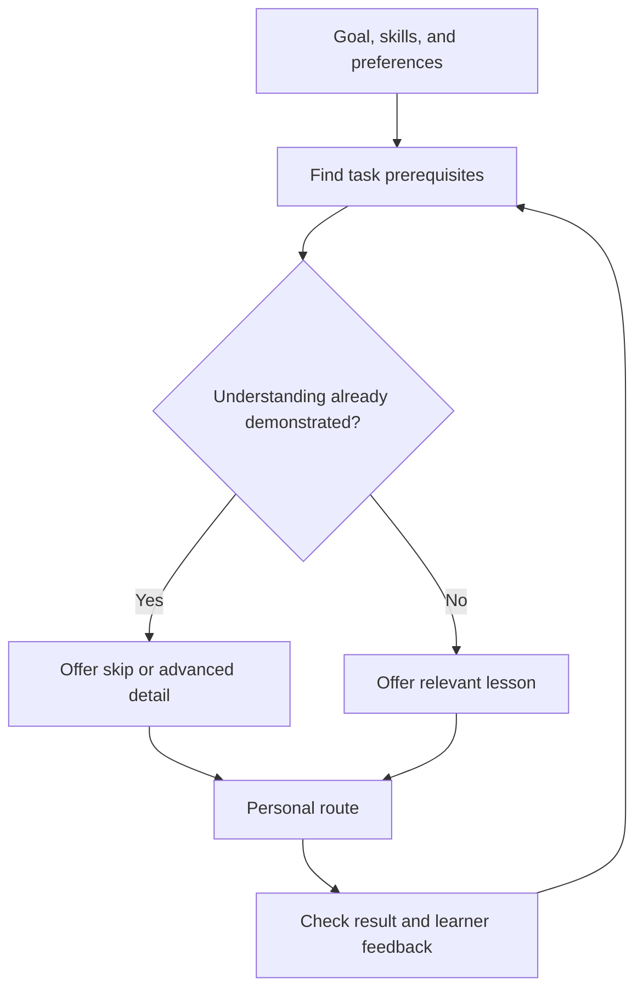

### Implementation

1. Ask for a contribution goal, existing skills, and preferred detail or pace.
2. Map the goal to required repository concepts and lessons.
3. Read demonstrated knowledge from reviewed assessment events, not self-report alone.
4. Apply simple rules to order lessons and explain why each is included.
5. Let learners skip, pause, change detail, or disable personalisation.
6. After a wrong branch answer, offer a focused explanation. Do not lower ability estimates because someone answers slowly.

**Store/API:** `learner_preferences`, `concept_states`, `learning_routes`; `POST /api/learning-routes`.

**Prototype:** Two profiles and two goals with explicit adaptation rules. A complex recommendation model is unnecessary.

**Done when:** Different goals produce meaningfully different routes and explicit pace preferences override automatic recommendations.

---

## 6. Feature 5 — Predict, Explain, Verify

**Meaning:** Ask a learner what happens next and which source condition explains it.

**Example:** “If this email already exists, will an insert happen? Select the deciding code.”

**Technology:** Reviewed question definitions, deterministic checks, optional human-reviewed explanation rubrics, React assessment controls.

### Diagram

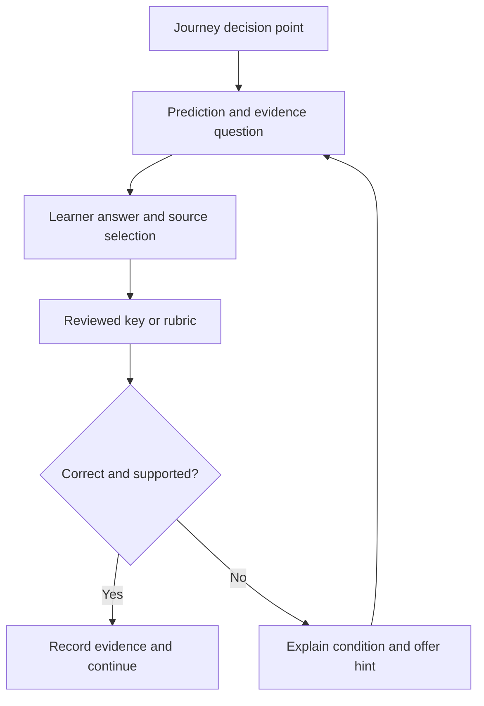

### Implementation

1. Prepare three to five meaningful questions from the chosen repository.
2. Save accepted outcomes, valid source references, and an explanation rubric.
3. Record first attempts, retries, and hints separately.
4. Use deterministic grading for structured answers. Allow equivalent correct source selections.
5. For free-text feedback, label model-assisted grading and review important results.
6. Update concept state through an event reducer with published rules. The tutor cannot invent a correct result.

**Store/API:** `checks`, `assessment_events`; `POST /api/checks/:id/attempts`.

**Prototype:** One branch check, one source-location check, and one transfer question without immediate hints.

**Done when:** Correctness follows the reviewed evidence; hinted success is distinguishable from independent success.

---

## 7. Feature 6 — First-contribution Practice Workspace

**Meaning:** Help the learner attempt a small, relevant code change and verify it.

**Example:** Add an endpoint validation rule and a test demonstrating it.

**Technology:** Task cards, patch upload or local workspace, isolated Docker execution worker, approved test recipes, persisted run results.

### Diagram

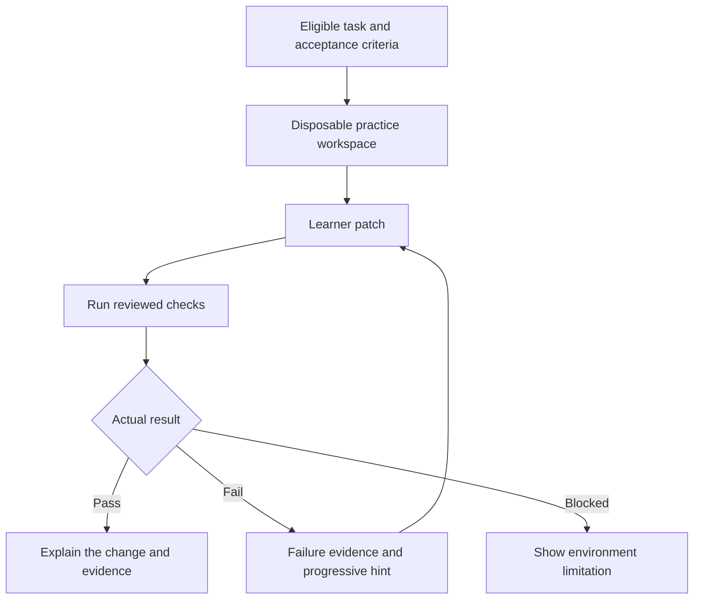

### Implementation

1. Prepare two or three candidate tasks with clear origin: public issue, curated exercise, or generated practice task.
2. Include desired behaviour, relevant files, prerequisites, acceptance criteria, and test commands.
3. Create a disposable workspace at the selected commit; never silently edit the original repository.
4. Record baseline results. Confirm the unmodified code fails the new requirement while existing baseline checks pass.
5. Apply the learner's patch and run an approved recipe with time, memory, and network limits.
6. Save exit status and redacted logs. Ask the learner why the change belongs in that component.

**Store/API:** `practice_tasks`, `practice_attempts`, `runs`; `POST /api/practice-attempts` and `GET /api/runs/:id`.

**Prototype:** Fully verify one prepared exercise. Use a local patch workflow before building a browser IDE.

**Done when:** The intended solution passes the new requirement, the unchanged code does not, and blocked execution is never presented as success.

---

## 8. Feature 7 — Living Decision & Failure Memory (expanded Design-decision Memory)

**Meaning:** Preserve why a design was chosen, why a previous failure occurred, and what was learned; human-supplied rationale requires verified authorship and explicit approval before it can become authoritative team knowledge.

**Example:** The code shows a queue, but not why the team chose asynchronous processing. Search existing decision records before asking the maintainer.

**Technology:** ADR/PR retrieval, SQLite question inbox, decision records, LLM drafting, authenticated human approval.

### Diagram

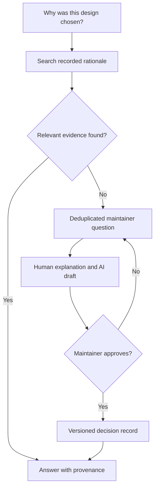

### Implementation

1. Search checked-in ADRs, retrieved discussions, and previously approved decisions.
2. When intent is missing, state that it is unknown rather than inventing a historical reason.
3. Create a local question tied to symbols and the snapshot; merge duplicate questions.
4. Let a maintainer supply intent, constraints, alternatives, and pitfalls.
5. Use the model to structure the response, then require an explicit human approval action.
6. Link the approved record to code, documentation, and journeys. Mark it for review after relevant changes.

**Store/API:** `maintainer_questions`, `decision_records`; `POST /api/maintainer-questions` and `POST /api/decisions/:id/approve`.

**Prototype:** One inbox-to-approval example. No automatic external messages or public issues.

**Done when:** Unapproved text stays unpublished and approved rationale has author, version, and source provenance.

### Accepted extension: failure memory and future change awareness

- Capture a **decision** (intent, constraint, rejected alternative) or a **failure lesson** (observed failure, reproduction evidence where available, verified resolution, preventive rule). These are different record types, not interchangeable.
- Trigger a proposed maintainer question from a PR, previously unresolved "why" question, postmortem, or explicitly shared failure. Asking a question is permitted; assuming the reason is not.
- Link approved records to commit(s), source reference(s), relevant tests and optionally incident/PR URLs. Keep original evidence immutable, and mark the record `needs_review` when dependencies change; do not silently rewrite history.
- An observed failing command is not automatically a confirmed root cause; preserve logs and label causal conclusions according to reviewed evidence.
- Show a relevant, approved warning during a future Code Journey, handoff, or contribution when changed code touches the associated constraint.
- Approval means the authenticated maintainer approved *the statement*, not that the system independently verified its truth. Support corrections, supersession, and explicit record withdrawal.

**Expanded MVP:** One maintainer-authenticated decision or failure record that can be found from a related code symbol, with one later source change marking it for review. No automatic publication from AI output. **Implementation status:** the uploaded application has a component discussion/draft/save mechanism and a separate local demonstration of approval, but authenticated multi-user maintainer approval and verified failure memory are not established by the source review.

---

## 9. Feature 8 — PR Impact Simulator and Journey Diff

**Meaning:** Show how a proposed code change affects the existing architecture and walkthrough.

**Example:** A branch adds email verification; the comparison shows changed conditions and a new external boundary if supported by code.

**Technology:** Git comparison, snapshot matching, selective reanalysis, dependency traversal, React Flow comparison, source diff viewer.

### Diagram

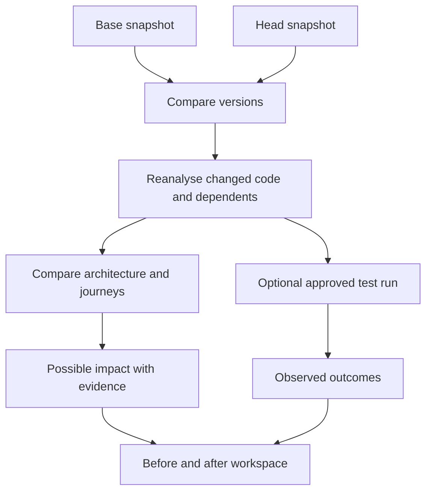

### Implementation

1. Resolve the comparison base and head to immutable commits; for a PR, use the relevant merge base.
2. Compare source files and reanalyse affected symbols, imports, configuration, and dependents.
3. Match entities using qualified names, paths, declaration kind, and structural evidence. Mark uncertain renames.
4. Show added, removed, and changed steps with old and new source references.
5. Label dependency-based findings as possible impact. Only actual execution may produce observed pass/fail claims.
6. Keep PR-preview material separate from the canonical main-branch snapshot.

**Store/API:** `comparisons`, `graph_diffs`, `journey_diffs`; `POST /api/comparisons` and `GET /api/comparisons/:id`.

**Prototype:** One prepared comparison. Do not promise to predict every runtime consequence.

**Done when:** The highlighted change is real, old citations still work, and possible impact is not confused with verified behaviour.

---

## 10. Feature 9 — Learning Drift and Targeted Relearning

**Meaning:** Detect when changed code affects something a particular developer previously learned.

**Example:** A learner correctly understood that registration enabled immediate login. A later change requires email verification. Show the new rule without pretending the earlier answer was wrong for the old version.

**Technology:** Artifact dependency index, comparison results, learner assessment events, rule-based invalidation, refreshed lesson generation.

### Diagram

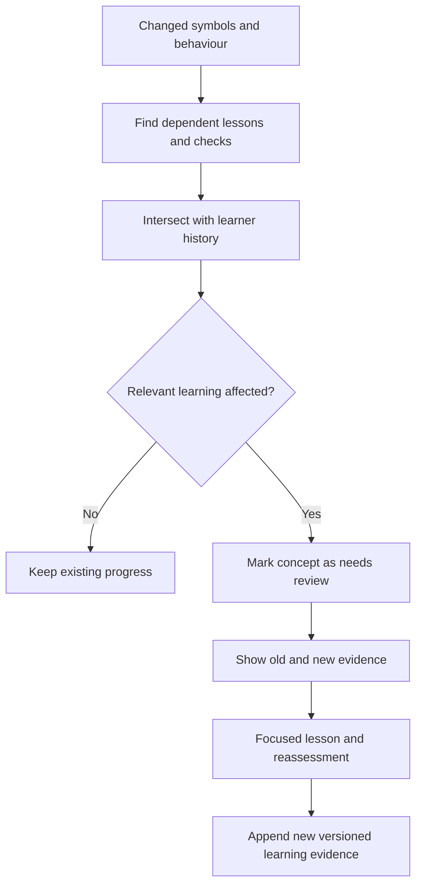

### Implementation

1. Save which symbols and claims support every lesson and check.
2. Save the snapshot and artifact version with each completed assessment.
3. When code changes, find affected artifacts, then the learners who studied them.
4. Treat dependency changes as candidates for review, not automatic proof of changed behaviour. Use supported comparisons and reviewed examples to explain the change.
5. Generate a short before/after explanation and one reviewed question.
6. Preserve historical success. Append new evidence rather than rewriting the old result.

**Store/API:** `artifact_dependencies`, `learning_updates`, `concept_states`; `GET /api/learners/:id/updates`.

**Prototype:** One changed condition, one affected learner, and one unaffected learner. If dependency analysis is uncertain, visibly widen review or reindex.

**Done when:** Only relevant learning is marked for review, and the new check measures understanding of the new version.

**Positioning:** This exact evidence-linked workflow is a proposed differentiator. Do not claim that no competitor has ever built related capabilities.

---

## 11. Feature 10 — Understanding and Peer Evaluation

**Meaning:** Track evidence that developers understand code and evaluate whether the mentor helps.

**Example:** Show that a learner correctly located validation and explained a failure branch, while data-access behaviour still needs review.

**Technology:** Assessment event log, deterministic reducer, SQLite queries, React progress view, CSV export.

### Diagram

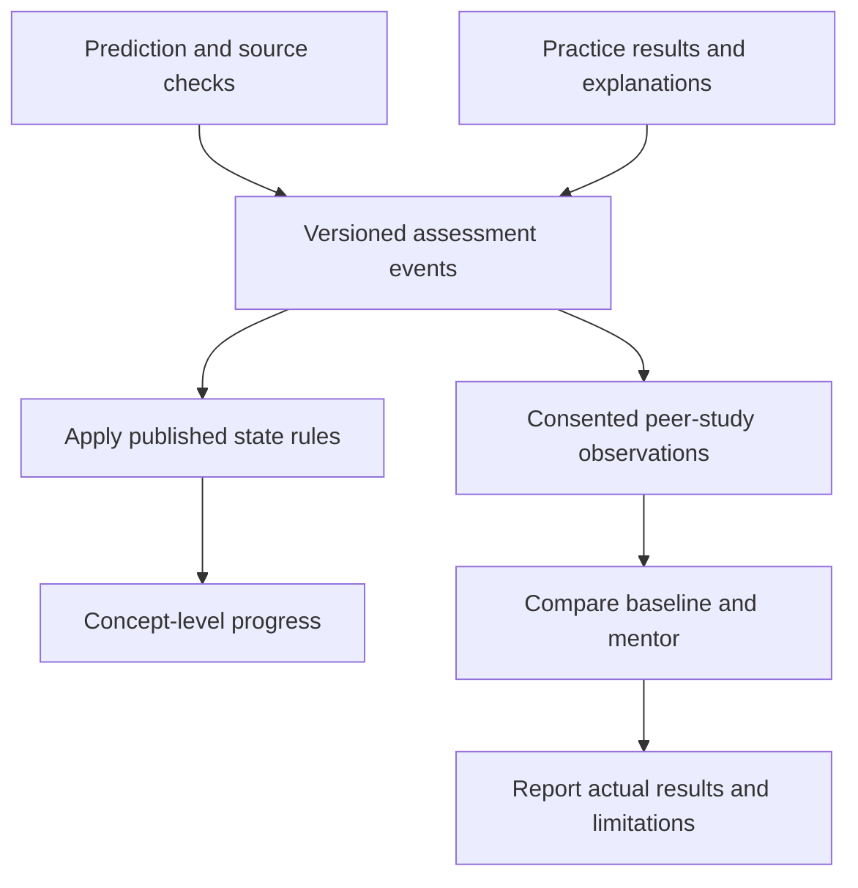

### Implementation

1. Track states such as not assessed, learning, demonstrated, and needs review.
2. Record correctness, source-location accuracy, hints, retries, and exercise outcomes.
3. Do not treat time spent watching a tour as demonstrated understanding.
4. Run a small study with roughly four to six consenting peers unfamiliar with the repository.
5. Use comparable task sets and vary their order between baseline and mentor conditions.
6. Report raw observations, median/range, correctness, and incomplete attempts. Describe the study as exploratory.

**Store/API:** `assessment_events`, `study_observations`; `GET /api/learners/:id/progress` and `GET /api/studies/:id/export`.

**Prototype:** One concept-progress view and a real, small evaluation when the product is usable.

**Done when:** Results are reproducible from events, no scores are fabricated, and anonymous data can be reset or deleted. A README comparison does not prove superiority over other AI products.

---

## 12. Feature 11 — Setup Drift Guard

**Meaning:** Find setup requirements that changed between repository versions.

**Example:** A PR adds an email-provider setting, runtime requirement, or migration. Show the supporting configuration and propose updated instructions.

**Technology:** Git diff, parsers for manifests/configuration, environment-variable usage analysis, Markdown patch generation; optional isolated execution.

### Diagram

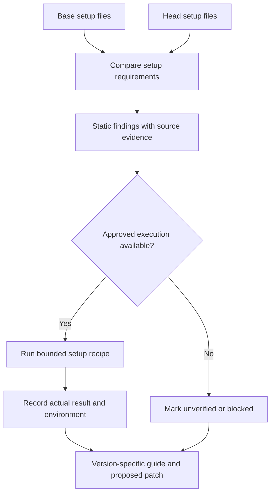

### Implementation

1. Compare runtime-version files, manifests, lockfiles, environment examples, migration files, scripts, and README setup instructions.
2. Locate new variable usage and inspect defaults or validation before calling a setting mandatory.
3. Generate a source-linked checklist and a proposed README patch.
4. If feasible, run a pre-approved recipe in a disposable container with synthetic configuration.
5. Record commit, environment, commands, exit status, and redacted logs.
6. Distinguish a code failure from unavailable credentials or external services. Use a fake provider where appropriate and label it.

**Store/API:** `setup_findings`, `setup_reports`, `runs`; `GET /api/comparisons/:id/setup`.

**Prototype:** Static delta and one reviewed documentation suggestion. Executed verification is an extension.

**Done when:** The prepared change is detected and no instruction receives a verified badge without an actual successful run of that step.

---

## 13. Feature 12 — Voice-guided Code Mentor

**Meaning:** Ask questions aloud while exploring the code and architecture.

**Example:** “Explain signup,” followed by “What happens if the email already exists?” The agent explains using the same source evidence as text Q&A.

**Technology:** ElevenLabs Agents, ElevenLabs React SDK, Express session endpoint, authenticated repository tool endpoints, validated frontend actions.

### Diagram

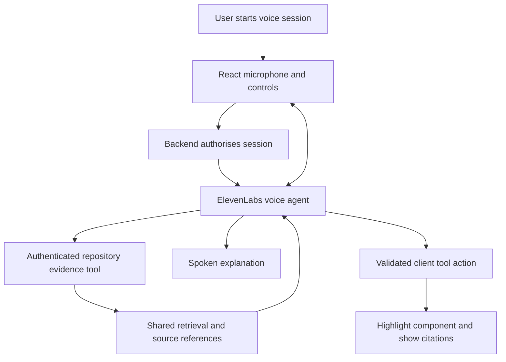

### Implementation

1. Add Start, Stop, mute, transcript, and connection-status controls. Request microphone access only after the user starts.
2. Create an Express endpoint that authorises the learner and selected snapshot before obtaining session access from ElevenLabs.
3. For WebSocket sessions, use a server-generated signed URL; for WebRTC, use the supported conversation-token flow. Never put the provider API key in browser code.
4. Configure a server tool such as `getRepositoryEvidence(question, componentId)` that returns bounded source context and reference IDs. Bind repository access to a server-side session; do not trust a model-supplied repository ID.
5. Configure the agent to use this tool for repository facts and state when evidence is missing.
6. Register client actions such as `highlightComponent(componentId)`, `openSource(sourceRefId)`, and `selectJourneyStep(stepId)`. Reject IDs not present in the authorised snapshot.
7. Display the supporting source references beside the transcript. Keep text Q&A available when voice disconnects.
8. On stop or logout, release microphone tracks and clear session state.

Client-tool timing is not guaranteed word-by-word speech synchronisation. Start with component-level highlighting. Precise synchronisation requires a separately tested timing mechanism.

**Store/API:** Minimal `voice_sessions` metadata; `POST /api/voice/session` and an authenticated voice evidence endpoint. Do not store raw audio by default; explain and control any transcript/provider retention.

**Prototype:** One real conversation about one repository, one follow-up, and one validated highlight action. If audio is prerecorded or browser-generated, label it as demo narration rather than live ElevenLabs integration.

**Done when:** A follow-up retains the right repository context, cited evidence is visible, invalid component IDs are rejected, and the session handles disconnects cleanly.

**Provider references:** [Agent authentication](https://elevenlabs.io/docs/eleven-agents/customization/authentication), [React SDK](https://elevenlabs.io/docs/eleven-agents/libraries/react), [JavaScript SDK](https://elevenlabs.io/docs/eleven-agents/libraries/java-script). Check installed SDK documentation during implementation because interfaces may change.

---

## 14. Feature 13 — Living Repository Documentation

**Meaning:** Detailed, searchable explanations linked to the same source and architecture used elsewhere.

**Example:** Click UserService to read its responsibility, important methods, dependencies, and related test expectations.

**Technology:** Shared evidence graph, LLM adapter, Markdown generation/rendering, SQLite artifact records, source references.

### Diagram

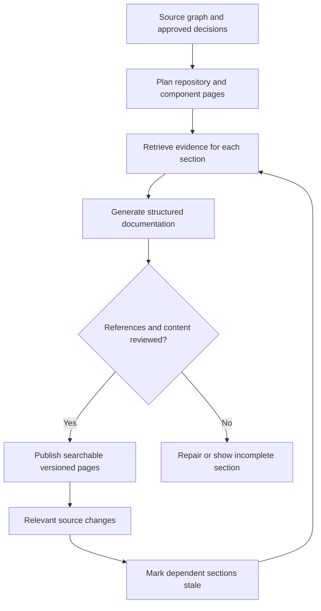

### Implementation

1. Generate an outline from actual project structure: overview, components, routes, flows, setup, configuration, and tests.
2. For each section, retrieve the corresponding code rather than relying only on another generated summary.
3. Generate an explanation with claim-level reference IDs and visible knowledge gaps.
4. Validate references and review representative claims. Sanitize rendered Markdown and source content.
5. Link documentation to component IDs and journeys; provide search, source navigation, and Markdown export.
6. Save section dependencies so relevant code changes trigger regeneration. Preserve the old version and display stale status during refresh.

**Store/API:** `documentation_pages`, `artifact_dependencies`; `GET /api/snapshots/:id/documentation` and `GET /api/snapshots/:id/documentation/export`.

**Prototype:** Project overview, architecture overview, and detailed documentation for the selected journey's components.

**Done when:** Documentation and architecture agree on component identity and snapshot; exported content retains citations and limitations.

---


---

# Part II — Additional features and existing bridge

## 15. Feature 14 — Runtime X-Ray Mentor / Code Theater

**Status:** discussed and retained in consolidated roadmap; **not implemented as real instrumentation** in the uploaded code.

**Problem:** A developer can read separate functions but struggle to understand the ordering, data changes, async operations, and branches in a real request or test. Static diagrams are insufficient when the question is "what actually happened?"

**User experience:** A branchable **rope-style timeline** moves a marker/dot through evidence-linked events. A small illustrated mentor shows what each event means. The learner can choose text/voice, pause at any event, ask a question without losing the playback position, and switch explanation depth. The character can use familiar visual metaphors for beginners and more technical data/call views for experienced developers.

### Required behaviors

1. **Two honesty-preserving modes:** `explained_path` follows a reviewed, source-supported possible flow; `observed_replay` follows a particular executed scenario whose events were captured. Prominently distinguish the two. Do not label UI animation as execution evidence.
2. **Animated timeline:** directed segments, forks, decision labels, current dot, start/next/back/pause/restart/speed, zoom-to-source and selected path. The highlighted source and illustration stay synchronized with the selected *playback event*.
3. **Explain the actual operation:** show function purpose, source condition, inputs/outputs when verifiably available, state changes, side effects and next relationships. Unknown data remains `unknown`, not invented example runtime values.
4. **Illustration library:** reusable reviewed scenes for HTTP request, validation, function call, database read/write, branch, queue, cache, error, promise/async, and response. AI chooses narration/scene parameters; deterministic data controls event order, branch and code citation. Dynamic generated art is not required for MVP.
5. **Contextual questions:** “Ask & Pause” freezes the *replay cursor*, not a live production process. “Ask in Sidebar” allows text exploration without discarding the event. Voice playback should pause/queue rather than talking over the answer. Store `traceId/eventId/snapshotId` with the question.
6. **Adaptive explanation:** beginner/intermediate/advanced, adjustable by the user; use reviewed predictions and selected preferences for suggestions. “Explain differently” changes analogy, visual density or technical detail. It does not rewrite the traced facts. Slow replies must not be interpreted as low ability.
7. **Interactive learning:** predict branch outcome, reveal evidence, replay a failure path and optionally compare two legitimately captured scenarios. If the input changes, execute a separately approved scenario before claiming an observed outcome.
8. **Boundary of evidence:** framework spans, instrumented branch events and recorded logs may cover only part of execution; mark unsupported async boundaries and missing spans. Never infer complete control flow from one import graph or one successful test.

### Suggested pipeline

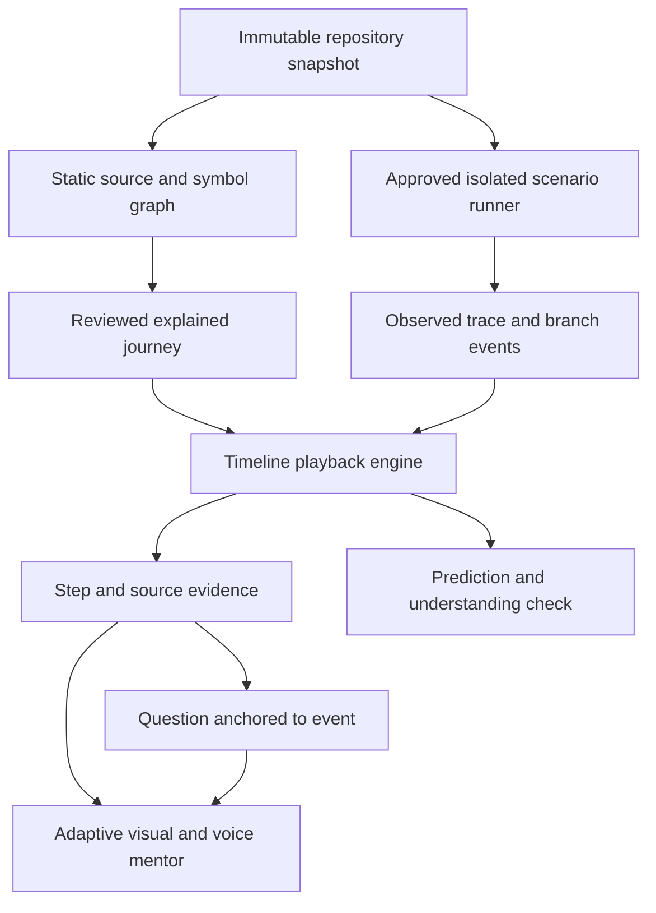

### Implementation boundary and data

- Initial scope: **one instrumented, controlled TypeScript/Express request**, one success case and one failure case, using approved tests/requests in an isolated environment. OpenTelemetry may help with spans, but branch-level behavior requires explicit instrumentation or hooks.
- Store: `runtime_scenarios`, `runtime_traces`, `trace_events`, `event_source_links`, `playback_checkpoints`. Suggested event fields: `id`, `traceId`, `parentEventId`, `sequence`, `timestamp`, `kind`, `sourceRefId?`, `observedFields?`, `observationCoverage`, `snapshotId`.
- API (proposed, not existing): `GET /api/snapshots/:id/scenarios`, `POST /api/scenarios/:id/runs` (approved recipe only), `GET /api/traces/:id`, `POST /api/traces/:id/questions`.
- **Safety:** strict execution limits; no host filesystem/network/secrets by default; never send sensitive runtime values to a voice/model provider; use redacted inputs; capture only explicitly authorized scenarios.
- **Graceful fallback:** when execution is blocked, show a reviewed explained path, visibly **not** a recorded execution.

**Acceptance:** A chosen event reopens correct source; each branch on an observed replay corresponds to recorded evidence; novice/advanced explanations preserve the same facts; a question pauses/resumes the same cursor; missing spans are disclosed; no fictional runtime values. Demo-only illustrations must be labeled demo.

---

## 16. Feature 15 — Smart Context Handoff

**Status:** explicitly accepted new feature; **not established as implemented** in the uploaded application.

**Problem:** A junior asks a senior why code behaves a certain way; the senior spends time locating the function, callers, related tests, relevant architecture and what the junior already tried before they can answer.

**Core interaction:** “Ask Senior about this” is available from the editor, cited Q&A, architecture node, Code Journey, documentation section and (when implemented) a specific Runtime X-Ray step. The system builds a compact **reviewable context package**, then creates a secure link to the same pinned context. The link can be sent in Teams, Slack or another channel without requiring those apps to be deeply integrated for the MVP.

### Context package requirements

| Field | Content | Evidence/permission rule |
|---|---|---|
| Question | Junior's wording and selected topic | Explicitly submitted by the user |
| Repository snapshot | Repository identity, commit SHA, selected branch/PR where relevant | Resolved by backend; never invented by LLM |
| Primary code | Exact function/file/line span and source reference IDs | Same immutable snapshot and authorized repository |
| Related context | Relevant callers, callees, route, typed edges, tests, docs, approved decisions | Each item cited and tagged with evidence strength |
| Prepared briefing | Concise current behavior, uncertainty, and reason for escalation | Model-drafted; user can inspect/remove items |
| Attempts so far | Optional user-selected checks, observations, attempted fixes | Never unrestricted chat logs by default |
| Playback link | Optional selected journey step or trace event | Only if both recipient and trace authorization allow it |
| Status | Open / needs context / answered / resolved / superseded | Durable state transitions with actor attribution |

### Workflow

1. Junior selects a code span or question; backend validates the selected snapshot and source reference.
2. Search F01/F07/F13 for an existing approved, relevant explanation. Offer it first; **do not claim it resolved the issue unless the user confirms**.
3. If escalation is needed, gather a small bounded evidence set and draft a briefing. Junior can edit the question and include/exclude attempts or source snippets.
4. Backend creates a **protected, revocable handoff identifier**. A share link directs an authorized recipient into the Context Handoff workspace at the correct snapshot and highlight. For private repositories, **link possession never replaces authorization**. Public repositories may permit an explicitly public/limited share only after a deliberate policy choice.
5. Senior reads, annotates exact code, replies, asks for more context, or creates a source-linked visual explanation. Replies carry actor/time/version provenance.
6. Junior sees the resolution attached to the original question and, if relevant, resumes the selected journey/trace event.
7. With authenticated maintainer approval and the right repository permissions, a durable decision/failure lesson can be published through **F07**, not automatically from a casual answer.
8. Changed supporting code marks a handoff as potentially stale via **F08/F09/F13**; preserve historical questions and answers.

### Secure link design

- Authenticate recipient; authorize **every** included repository, source reference, trace and artifact on each read. Use a server-generated opaque ID; never put raw code, secrets or provider tokens in URL/query strings. No private snippets in chat-link previews.
- Add owner controls: expiration, revocation, visibility, recipient or team restriction, audit trail, and ability to exclude snippets. Redact tokens/passwords and policy-sensitive files in retrieved context.
- Keep invitation vs access distinct: anyone may receive the URL; only authorized viewers see protected code.
- For a local hackathon prototype without real identity, either restrict to a **single machine/session** and mark it **local-only**, or implement a minimal real authentication/authorization model; do not market it as secure team sharing otherwise.

**Suggested storage:** `handoffs`, `handoff_context_items`, `handoff_messages`, `handoff_links`, `handoff_audit`, referencing existing `source_refs` and `decision_records`. **Proposed API:** `POST /api/handoffs`, `GET /api/handoffs/:id`, `POST /api/handoffs/:id/replies`, `POST /api/handoffs/:id/revoke`, `POST /api/handoffs/:id/resolve`.

**MVP gate:** Create one question about real analyzed code, manually review included evidence, open a protected link as an authorized second identity or clearly marked same-session demo, annotate and resolve it, and retrieve the correct pinned source. Unauthorized access must fail; no auto-approved knowledge record.

---

## 17. Feature 16 — Work Context Time Machine

**Status:** explicitly accepted new feature; **not established as implemented** in the uploaded application.

**Problem:** After days away from a branch or task, a developer must reconstruct which files matter, what was decided, what they tried, the unresolved questions, and what changed while they were away.

**Core interaction:** **Save checkpoint** during a task; later **Resume context** reconstructs the saved evidence, compares it with the current repository and displays a trustworthy next-action suggestion.

### Checkpoint contract

- **User identity, repository, task/issue ID, branch and pinned commit**; capture local working-tree state only after user permission and with a clear distinction from Git-committed code.
- **Selected code context:** relevant source references, watched components, optional related journey/trace position, important docs/decisions.
- **Explicitly saved understanding:** notes, intended implementation, decisions, discoveries, unresolved questions, and next step chosen by the developer. Do **not** claim to know the user's thoughts from open-file history.
- **Progress evidence:** explicit edits/commit links, known completed subtasks, previously executed checks with exact run IDs/status, and blocked/unverified items. No invented successful tests.
- **Privacy:** checkpoint scope preview and opt-in for saving editor context or summaries; per-user visibility, deletion, bounded retention; exclude secrets and raw terminal histories by default.

### Resume workflow

1. Developer opens a saved checkpoint associated with a task/branch.
2. Verify access and retrieve **the original** commit-pinned source. Never silently rewrite the checkpoint to HEAD.
3. Resolve current HEAD (if requested), compare selected files/symbols/requirements via F08 and display changed/stale/unknown context separately.
4. Reconstruct: “What you explicitly saved,” “What the repository changed,” “What remains unresolved,” “Suggested next action.” Each section shows source/provenance and date.
5. Restore saved workspace navigation and optional learning/journey position; let the user accept, edit or discard suggested next actions.
6. Support `resume`, `supersede`, `archive`, `export` and `delete`. Do not auto-run code, contact collaborators or overwrite a branch.

### Example

**Task:** Implement email verification. **Saved checkpoint:** token generation added; expiration behavior unresolved; one test observed passing. **On resume:** one related validation function changed since the saved commit. **Suggestion:** review the updated validation condition and rerun the approved test. The suggestion is *not* a claim that the new code broke the feature.

### Data and implementation

- Tables: `task_contexts`, `context_checkpoints`, `checkpoint_items`, `checkpoint_run_refs`, `checkpoint_resume_reports`. Include `ownerId`, `snapshotId`, `taskId?`, `branch?`, `savedAt`, `visibility`, `retentionPolicy`, `contentHash`, and references to prior artifacts.
- Proposed API: `POST /api/tasks/:id/checkpoints`, `GET /api/checkpoints/:id`, `POST /api/checkpoints/:id/resume`, `DELETE /api/checkpoints/:id`.
- Reuse F08/F09 for change/staleness detection, F06 for run evidence, F07 for approved rationale, and F03/F14 for saved playback location.
- **MVP:** one explicitly saved task checkpoint, a prepared meaningful code change between two real commits, and an honest resume summary that separates unchanged facts from changed facts and unresolved items.

**Acceptance:** Reopening restores saved context exactly; current-branch changes are shown without replacing old evidence; the developer's notes remain identifiable as user-provided; suggestions are labeled; deletion works; no private checkpoint is visible to another identity.

---

## 18. Feature 17 — Agent Context Bridge, with optional MCP/Plugin interface

**Status:** the application contains a **manual JSON/prompt export against its synthetic demo data** (`frontend/src/pages/AgentContext.tsx`). A real-repository export and live MCP/plugin server are **proposed**, not proven by the uploaded ZIP. This feature is included to ensure a visible existing screen is not omitted from the master catalogue.

**Problem:** A developer using an external coding agent frequently has to reconstruct architectural boundaries, environment requirements, task context and source evidence in the other tool.

### Current bridge experience

- Select a bundled sample revision and signup/login task, build a revision-bound context object, copy JSON or Markdown prompt text, or download locally.
- The exported context includes checked source slices from the sample, environmental **variable names** rather than values, and change/learning references.
- This is **manual handoff**; it does not demonstrate an external tool consuming the context automatically. No production behavior can be inferred from the demo's synthetic revision identifiers.

### Proposed production bridge (bounded scope)

1. Resolve user-authorized real repository snapshot, selected feature/task, relevant evidence, citations, documented constraints, and staleness metadata.
2. Export an explicit, size-limited **context bundle** with schema version, commit SHA, source reference IDs/URLs, evidence kinds, unresolved gaps, and expiry when shared.
3. For a possible MCP interface, expose read-only tools such as `list_authorized_repositories`, `get_snapshot_summary`, `search_symbols`, `get_source_excerpt`, `get_component_relationships`, `get_documented_decisions`, `get_journey_steps` and `get_task_context_checkpoint` (only for its authorized owner). Use a trusted server to enforce identity, snapshot, quotas, bounded outputs and audit logging.
4. **No default code writes, command execution, Git pushes, publishing decisions, or access to unapproved private context.** Any future write/action tool requires separate approval and isolation controls.
5. Treat repository text as untrusted data (prompt-injection risk). Never let retrieved comments change the tool permissions or recipient scope. Redact credentials and deny inaccessible files.
6. Return `unsupported/not found/unauthorized/stale` explicitly rather than inventing related source.

**Proposed data:** `agent_context_exports`, `agent_tool_audit`, `integration_grants` only if needed after a real provider/integration is selected. A simple authenticated read-only API can precede MCP; do not create a microservice solely to get a new acronym into the architecture.

**MVP:** a context export from one **real pinned repository**, manual copy/download, one validated external consumer path (or an honest demo contract), permission checks, and a reproducible example showing the exported source references resolve. MCP live tool calls are **not required** to satisfy the original challenge.

---

# Part III — Integrated architecture, data and delivery

## 19. One combined architecture for the consolidated product

This is the **architecture of Codebase Mentor**, not the analyzed repository. Arrows represent intended information dependencies—not measurements of runtime latency. Existing/demonstrated/planned feature status is controlled by the catalogue above.

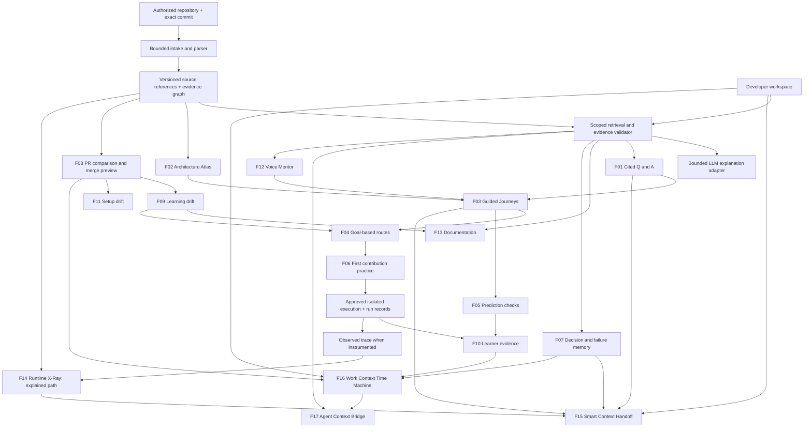

### Shared constraints

- Source facts belong to an immutable repository snapshot (commit SHA plus validated path/range/hash). Tests and actual observed run events use separate evidence kinds.
- Each artifact declares provenance and dependencies; if code changes, re-evaluate or mark stale—never silently rewrite past evidence.
- User/private artifacts (handoffs, checkpoint notes, runtime recordings, chat, agent integrations) need authorization beyond the original local single-user server. **Implement authorization before exposing network-reachable collaboration links.**
- Existing demo fixture revisions remain clearly labeled, never mixed with real Git history or observed execution.
- Deterministic modules own parsing, record matching, source-link construction, timeline ordering, access rules, test-result interpretation, version comparisons and approval state transitions. Models may suggest, explain and draft; they do **not** invent source coordinates, execution outcomes, identities or approvals.
- Preserve source-linked answers in every UI: source viewer, architecture, journeys, Runtime X-Ray, senior annotations, agent export and checkpoint resume should refer to the **same** snapshot/references when showing the same claim.

## 20. Agent roles without unnecessary infrastructure

Keep these roles as modules under a coordinator initially. Some operations are deterministic functions, not model calls. The LLM can explain and propose; it must not fabricate source facts, passing tests, human approval, or learner results.

| Role | Work | Features supported |
| --- | --- | --- |
| Coordinator | Creates bounded jobs, checks tool permissions, handles failures | All |
| Repository Scout | Reads snapshot metadata and capability profile | Foundation |
| Code Analyst | Extracts symbols, routes, and supported relationships | 1, 2, 3, 8, 13 |
| Evidence Verifier | Checks reference identity and output structure; supports reviewed semantic evaluation | All generated material |
| Architecture/Journey Builder | Groups components and assembles reviewed paths | 2, 3 |
| Maintainer Knowledge | Searches intent, drafts questions, structures human responses | 7 |
| Learner Model | Applies explicit state and adaptation rules | 4, 5, 9, 10 |
| Mentor/Tutor | Explains retrieved evidence at the requested detail | 1, 3, 5, 12, 13 |
| Contribution Coach | Selects eligible tasks and progressive hints | 6 |
| Change/Learning | Compares artifacts and identifies relevant review needs | 8, 9 |
| Setup/Validation | Finds setup deltas and requests approved test recipes | 6, 11 |
| Runtime Trace & Timeline | Owns approved execution events, event ordering, and truthful explained-vs-observed replay; LLM only narrates | 14 |
| Handoff & Access | Builds user-reviewed context packages, authorizes links, records replies and approvals | 15, 7 |
| Context Continuity | Saves user-selected checkpoints, diffs versioned context, prepares honest resume reports | 16, 8, 9 |
| Agent Context & Tool Gateway | Creates bounded export bundles; optionally supplies read-only MCP tools with server-side permission checks | 17 |

The original specification's A1–A10 roles combine code analysis and evidence verification in A3. The additional roles above are responsibilities, **not additional autonomous services**. Keep modules inside the current backend until separation has a measurable need.

Every model task should declare its snapshot scope, allowed tools, timeout, token budget, and retry limit. The trusted coordinator supplies permissions. Repository comments cannot expand those permissions.

## 21. Shared data and events

| Record | Key fields | Why it matters |
| --- | --- | --- |
| Snapshot | repository, commit SHA, status, capability profile | Keeps all facts tied to one version. |
| Source reference | snapshot, path, lines, content hash | Makes evidence inspectable. |
| Graph node/edge | IDs, kind, references, relationship status | Powers architecture and retrieval. |
| Artifact | type, snapshot, dependencies, revision, freshness | Supports documentation and lesson updates. |
| Assessment event | learner, check revision, snapshot, attempt, hints, outcome | Preserves what was demonstrated. |
| Decision record | rationale, intent type, author, approver, version, status | Keeps human knowledge accountable. |
| Run | recipe, commit, environment, actual status, logs | Prevents invented execution claims. |
| Learning update | changed concept, old/new evidence, learner, review state | Makes relearning targeted. |
| Runtime trace/event | run ID, snapshot, event/parent IDs, source mapping, redacted observations | Drives honest recorded replay. |
| Handoff | creator, snapshot, question, context refs, recipient restrictions, status, expiry | Enables precise authenticated collaboration. |
| Handoff reply | actor, annotations, exact refs, timestamp, revision | Preserves senior explanation and resolution. |
| Context checkpoint | owner, task, branch, pinned snapshot, notes, run refs, selected source | Supports explicit task resumption. |
| Agent export | owner, snapshot, content manifest, scope, expiry | Provides bounded, auditable integration context. |

Useful internal events:

```text
snapshot.indexed
question.answered
journey.stepViewed
check.submitted
practice.runCompleted
decision.approved
comparison.completed
artifact.markedStale
learning.reviewRequested
trace.recorded
handoff.created
handoff.resolved
handoff.revoked
checkpoint.saved
checkpoint.resumed
agentContext.exported
```

Store idempotency keys for retryable jobs so duplicate events do not create duplicate lessons or results. Persist completed artifacts and failures. A single backend event dispatcher is enough for the prototype; Kafka is not required.

## 22. Suggested code organisation

| Directory | Responsibility |
| --- | --- |
| `frontend/src/features/architecture` | Graph and component details. |
| `frontend/src/features/journeys` | Step player, source panel, and scenarios. |
| `frontend/src/features/documentation` | Documentation navigation and export UI. |
| `frontend/src/features/questions` | Cited chat answers. |
| `frontend/src/features/learning` | Routes, checks, progress, and relearning. |
| `frontend/src/features/practice` | Task briefs, patches, and run results. |
| `frontend/src/features/changes` | PR, journey, and setup comparisons. |
| `frontend/src/features/voice` | Voice controls and validated client actions. |
| `frontend/src/features/maintainer` | Question inbox and human approval. |
| `backend/src/repositories` | Repository access and snapshot lifecycle. |
| `backend/src/analysis` | TypeScript and Express adapters. |
| `backend/src/evidence` | Retrieval, references, graph queries, and validation. |
| `backend/src/agents` | Bounded orchestration modules. |
| `backend/src/learning` | Assessment rules and event reducers. |
| `backend/src/workers` | Analysis jobs; isolated execution integration. |
| `shared/contracts` | Shared data schemas and API types. |
| `frontend/src/features/runtime-xray` | Rope timeline, illustrations, replay cursor, evidence panel. |
| `frontend/src/features/handoffs` | Context preparation, link sharing, senior annotation, resolution. |
| `frontend/src/features/checkpoints` | Checkpoint capture and resume comparison. |
| `frontend/src/features/agent-context` | Real-repository export and optional plugin-tool status. |
| `backend/src/trace` | Validated trace/event adapters and playback event queries. |
| `backend/src/handoffs` | Authorization, scoped packages, replies and auditing. |
| `backend/src/checkpoints` | Checkpoint CRUD and version-diff resume reports. |
| `backend/src/integrations` | Future read-only agent context bridge / MCP adapter. |

Reuse existing project structure where possible instead of creating parallel implementations.

## 23. Practical build order — retain the mandatory scope

Do not interpret the full catalogue as a promise that 17 features fit in a 24-hour finale. The stages below are **priorities and exit gates**, not estimated schedules.

| Phase | Deliverable | Gate before continuing |
|---|---|---|
| A — Trustworthy source foundation | Pinned real GitHub snapshot, parser, references, limitations and evidence index | Supported routes/calls and unresolved edges are honest; links point to correct commit |
| B — Challenge Stage 2 | F01 Q&A, F02 architecture, F13 source-grounded docs on one **real** repo | Five representative cited answers inspected by a human; no cross-snapshot source mixing |
| C — Required learning showcase | F03 success/failure Journey, F04 basic goals, F05 prediction, F10 basic progress | Real-code reviewed steps or unmistakably labeled prepared fixture; actual assessment rules |
| D — First contribution | F06 one prepared, reproducible change/test workflow | Baseline, failing new requirement and passing intended solution actually recorded; otherwise label demo-only |
| E — Knowledge and versioning | F07 approved rationale, F08 real PR comparison, F09 relearning, F11 static setup delta | One approved human-origin record and one real code delta with correct invalidation |
| F — Practical collaboration MVP | F15 selected code → prepared briefing → authorized link → annotated reply → resolved state | Recipient auth enforced, pinned source opens, no private code in unauthorized previews |
| G — Continuity MVP | F16 explicit checkpoint → later real commit delta → resume report | Reopening preserves saved notes, surfaces changed evidence and avoids invented progress |
| H — Runtime X-Ray MVP | F14 animated explained path; optionally one isolated instrumented request with trace | Explained vs recorded unambiguously labeled; branching aligns with source or captured events |
| I — Existing bridge completion | F17 real-snapshot agent context export; optional read-only MCP tool | Source coordinates, access scope and snapshot validated; never hidden write capability |
| J — Voice and user study | F12 contextual voice and F10 small consented peer study | Responses show evidence; study observations are real and limitations disclosed |

**Hackathon cut line:** Prioritize A–D and an honest evaluation first. Add one or two of F15/F16/F14 as demonstrable USPs **only after** Stage 2 requirements remain solid. F17 MCP and broad arbitrary runtime instrumentation are stretch goals. A local-only two-person handoff demo must visibly say it is **not secure multi-user sharing**.

---

## 24. Verification checklist

- [ ] Each request is authorised for its repository, snapshot, and learner.
- [ ] A route resolves to the correct handler in supported patterns.
- [ ] Imports and actual supported calls remain distinct.
- [ ] Unknown dynamic calls are not filled in with model guesses.
- [ ] Answers cannot cite references from another snapshot.
- [ ] Representative claims are manually checked for semantic support.
- [ ] All journey controls update diagram and source together.
- [ ] Assessment events reproduce the same concept state.
- [ ] Human approval is required before publishing maintainer rationale.
- [ ] The prepared code change refreshes the right lessons and documentation.
- [ ] Historical learning evidence is retained.
- [ ] Setup findings distinguish static evidence from executed verification.
- [ ] Repository scripts run only through approved isolated recipes.
- [ ] Voice cannot highlight unknown or unauthorised component IDs.
- [ ] Disconnecting voice stops microphone use and preserves text access.
- [ ] Model credentials and secret source values are not exposed.
- [ ] Demo narration, precomputed artifacts, and recorded runs are labelled.
- [ ] Peer-study results remain empty until actually collected.
- [ ] Every feature is labeled **real, demo-only, or planned**; no fixture result is shown as live-repo execution.
- [ ] F07 decision/failure records require verified maintainer attribution and approval for authoritative publication.
- [ ] F14 explained-path dots cannot be mistaken for captured runtime traces; trace coverage and redaction are visible.
- [ ] F15 handoff links enforce repository authorization on every request; revocation and expiry are tested.
- [ ] F15 seniors can open exact pinned source; no private snippets leak through previews or links.
- [ ] F16 restores the saved checkpoint and separately reports changes since that snapshot.
- [ ] F16 never invents user intent, completed tasks, or test results.
- [ ] F17 external context has no secret values, unauthorized source, or unnoticed write permissions.
- [ ] Live PR merge previews are not presented as GitHub merges or production execution.
- [ ] Any third-party data/LLM/voice retention is disclosed and user-controlled as feasible.

## 25. One connected presentation example (consistent with current implementation boundaries)

Pick **one real public TypeScript/Express repository**, one pinned commit and one recognizable feature. Use this connected story, shortening it to what actually works on the demo date:

1. Analyze the real repository; show the exact commit and analysis limitations (foundation).
2. Show the Architecture Atlas and source-linked documentation (F02/F13).
3. Ask a grounded “how/why” question; open the cited source. For unknown intent, say it is unknown (F01/F07).
4. Follow a reviewed success/failure journey and make a prediction (F03/F05). **Do not replace it with an unlabeled synthetic demo and imply it ran on the live repo.**
5. Show a prepared starter task, honest assertion/verified test result and reflection (F06/F10).
6. Ask a senior about the exact step using a **user-reviewed Smart Context Handoff**; share a protected link and obtain an annotated response (F15, only if auth is genuinely present).
7. Save the developer's checkpoint; compare to a later commit and show the resume summary (F16, only if implemented).
8. If implemented, play a trace-backed Runtime X-Ray scenario; otherwise show a clearly tagged **Explained Path** (F14).
9. Show a real PR comparison, possible impacts and setup changes (F08/F11), then an affected learning item (F09).
10. Demonstrate a maintainer-approved decision/failure lesson being retrieved later (F07), and a bounded context export for an agent (F17, manual if MCP not built).
11. Finish with **actual** peer-study observations, or transparently display the pending evaluation protocol (F10).

**Presentation positioning:** “From unfamiliar repository to source-backed understanding, a first contribution, precise expert help, and retained context when work and code change.” The animated tutor and secure handoff support this mission; they do not replace required cited Q&A or a real repository demonstration.

---

## 26. Source material and technical references

### Project sources

- User-provided `Codebase_Mentor_Final_Project_Specification(1).md`, Revision 3: original 11 features, evidence model, agent roles, scope, and evaluation protocol.
- User-provided first-round CODE APEX presentation: proposed stack, architecture, feature screens, scope, and expected impact.
- Conversation additions: ElevenLabs voice-guided architecture understanding and a separate detailed documentation implementation.

### Official implementation references

- [TypeScript Compiler API](https://github.com/microsoft/TypeScript/wiki/Using-the-Compiler-API) — symbols, declarations, and source analysis.
- [React Flow custom nodes](https://reactflow.dev/learn/customization/custom-nodes) — interactive graph components.
- [React Flow custom edges](https://reactflow.dev/learn/customization/custom-edges) — relationship rendering.
- [SQLite FTS5](https://www.sqlite.org/fts5.html) — text retrieval.
- [ElevenLabs agent authentication](https://elevenlabs.io/docs/eleven-agents/customization/authentication) — server-managed voice session access.
- [ElevenLabs React SDK](https://elevenlabs.io/docs/eleven-agents/libraries/react) — React integration and client tools.
- [ElevenLabs JavaScript SDK](https://elevenlabs.io/docs/eleven-agents/libraries/java-script) — connection mechanisms.

These references support technology choices; they do not establish that every target feature is implemented, that this combination is globally unique, or that customers will pay for it. Pin compatible dependency versions during development and keep the actual implementation status visible.


## 27. Final reconciliation and explicit exclusions

### Inventory reconciliation (auditable)

- **13 original** feature areas from the supplied guide: F01–F13; no deletion.
- **1 accepted enhancement**: Living Decision & Failure Memory integrated into **F07**; no double counting.
- **2 explicitly accepted new additions**: Smart Context Handoff (F15) and Work Context Time Machine (F16).
- **1 previously discussed visual/runtime addition**: Runtime X-Ray Mentor (F14), described honestly as proposed.
- **1 existing interface absent from original 13-feature guide**: Agent Context Bridge (F17); manual fixture export is present, live MCP/plugin tool support remains a proposal.
- **Supporting existing functionality retained**, not double-counted: live Mentor Workspace and source/code editor, component discussion, genuine public PR analysis, local PR Merge Simulator, Markdown documentation exports and repository capability reports.
- **Not silently adopted:** CI Failure Courier, Review-to-Learning Loop, Expert Finder, Requirement Reality Check and other brainstormed concepts named in the TL;DR. They remain candidates for future decisions.

### Questions to resolve in engineering, not assumptions to fill with AI

- Which GitHub authentication/organization model will authorize shared private repositories? Current local server does not solve it.
- Which real repository and test recipe will be used for the finale? Select after confirming executable coverage, not by relying on imaginary function names.
- Which runtime events can instrumentation truthfully capture without intrusive source rewrites?
- Who may approve authoritative decisions/failure lessons, and who may view their incident metadata?
- What retention, audit and revocation policy applies to handoffs, checkpoint notes, audio and trace data?
- Is production MCP needed for the next milestone, or is validated manual context export enough?

### Final acceptance principle

A Codebase Mentor feature is **done** only when its primary behavior works with the declared repository/version, provenance is visible, missing evidence stays missing, and its negative/security cases are tested. **A visually polished screen is not proof of implemented data flow.**
