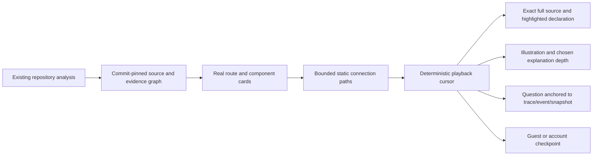

# CodeJourney: actual repository paths

The Code Journeys page now uses the repository already analyzed in Repository and Mentor workspace. It no longer fills the library with the included signup/login teaching examples. No repository means an empty state with an Analyze repository link. A failed request shows an error, never sample cards.

## Developer workflow

1. Analyze a public repository in **Repository**, or reuse the existing analyzed snapshot.
2. Open **Explore → Code Journeys**, or use the CodeJourney button in Mentor workspace. No new repository or PR URL is needed.
3. Search the loaded cards by real component name, route, role or file. HTTP routes appear first. Cards show the actual commit, source-event count and connection-path count. Difficulty is unrated; no duration estimate is invented.
4. Start a journey. Back, Next, Play, Pause, Restart and speed move the replay cursor through source connections. The selected component, explanation, illustration and complete source file stay synchronized.
5. Select another connection path to explore another resolved chain. These alternatives are not labelled success/failure or true/false unless execution evidence exists. Different outgoing calls do not prove mutually exclusive branches.
6. Use **Zoom to source**, or open exact declaration and connection evidence on GitHub at the pinned commit.
7. Choose beginner/intermediate/advanced detail, optional browser narration, Ask & Pause or an anchored sidebar question. A question preserves its trace/event/snapshot binding. Signing in does not reset the active cursor.
8. Resume guest progress from browser storage or account progress from SQLite. Exploring another path preserves main-path completion history.

The library loads 60 actual components per page. Load more retrieves the next page; the UI shows loaded/total counts. Search and filters currently apply to loaded cards. Global search uses the first page of repository journeys. There are no generated difficulty scores, artificial failure scenarios or sample runtime values.

## How the real data is built

`repositoryJourneys.js` reads `snapshots.graph_json`, `source_files` and source references from the existing immutable analysis. IDs contain both the snapshot and real component ID: `repo-<snapshotId>-<componentId>`.

It follows supported `handles_route`, `calls` and database relationship edges. Imports alone never become execution paths. Application/router/module containers are not used as component cards. Every step opens the original component reference; every displayed connection retains its separate call/registration reference.

The TypeScript parser extracts declared parameters, return expressions and conditions from available saved source. These are labelled source syntax. Parameter values, evaluated return values, side effects, branch outcomes and timings remain unknown. If a snapshot has only a saved reference excerpt, the full file is retrieved through the existing bounded source endpoint at its exact commit; a source retrieval failure is shown rather than replaced with example code.

Expansion is bounded to 16 paths, 10 events per path and 64 components. Cycles are not replayed indefinitely. Reaching a bound is disclosed in coverage. Missing/dynamic edges and the snapshot's unresolved relationships are also disclosed. A bounded four-entry cache avoids rebuilding frequently opened paths; source snapshots provide persistent version identity.



## Evidence modes

**Explained path:** the repository view is a source-derived connection chain, not an executed request. The mode badge and coverage say so. Call order, middleware sequencing, asynchronous scheduling and taken conditions are not established by the graph. Source-derived explanations are templates based on actual metadata; they are not runtime observations or a human-reviewed proof of behavior.

**Observed replay:** no approved capture recipe exists for arbitrary analyzed repositories. Consequently the repository view does not display the example signup runner button or claim that its code was executed.

The earlier controlled TypeScript/Express signup recipe and fixed Docker capture adapter remain available as developer infrastructure. Its two allowlisted cases are success and invalid email. They are separate from user repositories and accessible only through explicit example/developer APIs, not as fallback library content. Docker's Linux engine was unavailable during implementation; actual captures remain unverified.

The controlled adapter uses no shell, host mounts, application secrets or published ports. Runtime flags disable external networking, make the root filesystem read-only and restrict memory, CPU, processes, temporary storage, time and output. An operator may provision its fixed image from the project root:

```powershell
docker build -t codebase-mentor-journey-runner:1 backend/journey-runner
```

No repository script is executed by the real-source library. Container isolation details are documented in Docker's [run reference](https://docs.docker.com/engine/containers/run/).

## Mentor, voice and AI

The purple theme and original application logo are reused. The branching CodeJourney mark uses SVG; deterministic UI state selects the supplied companion artwork. Scene illustrations are labelled metaphors, not telemetry. Explanation depth changes detail, not source facts or playback order. Response speed is never used to assess a learner's ability.

CodeJourney uses six supplied PNGs renamed under `frontend/public/mentor/`: `shishimaru-welcoming.png`, `shishimaru-thinking.png`, `shishimaru-encouraging.png`, `shishimaru-explaining.png`, `shishimaru-curious.png` and `shishimaru-celebrating.png`. Duplicate public originals were removed after checking their hashes. The application logo is the image-load fallback. UI state and a validated expression enum select the pose; a model cannot provide arbitrary image URLs. Celebration marks playback completion, not execution success.

The old visual-mentor card below the diagram is removed. The diagram and source panel now use the full available main-workspace width, with source directly below the canvas. Fresh journey opens select the first component and automatically show Shishimaru on both desktop and mobile. Desktop reserves 400px on the right below the app header; mobile uses a full-width overlay. The header uses the supplied mascot and the invitation to explore, followed by a current-component card, a detailed numbered How it works walkthrough, View source, and collapsed About this component controls. Closing leaves a compact 56px mentor icon for reopening. Continue journey explicitly uses resume=1 to restore a saved cursor; fresh and completed Revisit opens start at the beginning. Close or Escape hides it without resetting playback; the same-event question draft and answer survive reopening. The middle scrolls independently; the header and bottom question composer remain in place. Active-event changes update its title, source link, summary, learning controls and question context. An in-flight question is aborted when its component unmounts. Narration, predictions, illustrations, source facts and team knowledge remain available inside the drawer. The compact full-width source viewer retains syntax colors, line numbers, selection highlighting, copying, wrapping, source links and expansion.

The timeline uses the existing React Flow library as a dotted canvas, matching the architecture view. Drag the background to pan, scroll or pinch to zoom, and drag individual steps to reposition them. Zoom in, zoom out and Fit view controls sit in the lower-left corner. Moving the canvas or a node does not advance playback or change evidence links. Node positions remain in place during playback updates; reopening a journey restores the initial layout. Alternate nodes open their explained scenarios; observed replay only shows recorded events. The mentor panel and its explanation retain bounded reading areas; mobile uses normal page scrolling around the canvas and explanation. Illustrations are available under Visual explanation.

How it works automatically shows 3 to 7 titled explanation steps, with up to two short sentences and a source link for each step. Route explanations include bounded source from their resolved request handler, allowing the mentor to explain actual declared inputs, validation conditions, delegation, return/response expressions and error handling where the supplied code supports them. Handler facts cite the handler reference instead of being attributed to the route registration. The API retains the three-sentence overview for compatibility and adds steps plus canonical sourceReferences. Missing citations or a model-supplied reference outside the selected component and its supplied handler evidence are rejected. There is no generation button or provider branding.

A loading skeleton appears while generating the walkthrough. Source-only fallback builds up to seven distinct steps from actual analyzed route/handler facts and labels missing runtime evidence. It does not invent validation, status codes, business purpose or observed side effects. The existing In this code section still shows inputs, return expressions and conditions for the currently selected component.

Summaries use bounded in-memory server and browser caches keyed by snapshot ID, component key and source hash, plus explanation depth, evidence mode and adjacent path components so different contexts are not confused. Observed summaries are additionally scoped to the trace and its authenticated owner. Valid generated summaries expire after one hour; fallback context expires after 20 seconds. Concurrent requests for the same key share one generation. The walkthrough cache includes a format version so older short explanations are not reused. The browser debounces new steps by 180ms and ignores obsolete callbacks, with a render-time key guard so old text cannot appear beneath the new component title. Closing and reopening reuses the cache; caches do not survive process/browser restarts. Summary reads do not insert discussion questions or move playback.

Browser voice reads text through browser/system speech synthesis; it is not the separate ElevenLabs live agent. Narration is cancelled when a follow-up is submitted. Audible speech was not manually verified.

Event questions optionally use the existing `LLM_API_KEY`, `LLM_BASE_URL` and `LLM_MODEL` configuration. Source and question are treated as untrusted data. Only bounded selected-event source, source ID, coverage and the chosen explanation are supplied. Raw runtime observations are not forwarded. The returned citation ID must match that event. Missing credentials/provider failure returns labelled extracted source guidance focused on the question: checks/changes, inputs/returns or connected components. Resolved connections use component names rather than internal IDs, and design reasons remain explicitly unestablished. Replies use wrapping paragraphs and scroll into view within the drawer. Citation validation does not prove the generated explanation correct. After switching to the configured OpenAI-compatible endpoint and qwen2.5-codebase:latest, the live connection diagnostic succeeded and a controlled-source journey explanation returned five detailed steps with valid route and handler citations. Other adapters retain their mocked citation and failure-path checks. No user repository code was sent during these live checks.

## APIs

All paths below begin with `/api`.

`GET /traces/:id/events/:eventId/explanation?level=beginner` returns the overview sentences, detailed steps, canonical sourceReferences, generation status and validated snapshot/component/source anchors. Explained paths use the same public source access as the existing source API; observed replay requires its owner account. It never accepts client-supplied code or runs repository scripts.

| Endpoint                                            | Actual behavior                                                                                |
| --------------------------------------------------- | ---------------------------------------------------------------------------------------------- |
| `GET /codejourneys?snapshotId=<id>&page=1`          | Actual repository cards, total, page and hasMore. Unknown snapshots fail.                      |
| `GET /codejourneys`                                 | Empty list and analyze-repository notice.                                                      |
| `GET /codejourneys?examples=true`                   | Explicit developer teaching catalog; never requested by the normal repository library.         |
| `GET /codejourneys/:id`                             | Component journey from its pinned analyzed snapshot.                                           |
| `GET /codejourneys/:id/scenarios/:scenario`         | Deterministic source-derived trace, without executing code.                                    |
| `GET /snapshots/:id/source?referenceId=...`         | Existing complete commit-pinned source endpoint, used by the player.                           |
| `GET /journey-snapshots/:id/source?referenceId=...` | Validated evidence source, supporting actual repository references and legacy teaching source. |
| `GET /traces/:id`                                   | Source-derived trace or owner-only captured trace.                                             |
| `GET /codejourneys/progress`                        | Signed-in user's checkpoints.                                                                  |
| `PUT /codejourneys/:id/checkpoint`                  | Validates trace/event/snapshot, visited events and completion before storing.                  |
| `POST /traces/:id/questions`                        | Owner-scoped event question with snapshot and citation validation.                             |
| `GET /snapshots/:id/scenarios`                      | Registered execution recipes only; no fake instrumentation for repository snapshots.           |

Developer capture infrastructure also retains `GET /codejourneys/runner`, `GET /codejourneys/:id/runs` and `POST /scenarios/:id/runs`. The last requires authentication, a fixed allowlisted recipe and `{ "approved": true }`. Arbitrary commands, inputs and trace uploads are not accepted.

## Storage and files

Repository evidence reuses `snapshots`, `components`, `relationships`, `source_references` and `source_files`; it does not copy example source into a repository snapshot. Questions use `journey_questions`, containing user, trace/event/snapshot IDs, text and answer. Account progress uses `playback_checkpoints`. Guest progress is schema-validated browser storage; malformed entries are discarded without crashing playback.

Legacy capture infrastructure uses `runtime_scenarios`, `runtime_recipe_sources`, `runtime_traces`, `trace_events` and `event_source_links`. A teaching source hash is labelled separately from a Git commit. Controlled captures are owner-scoped and validated before transactional insertion.

Backend ownership: `repositoryJourneys.js`, `journeyCatalog.js`, `journeyRoutes.js`, `journeyService.js`, `journeyStorage.js` and `journeyRunner.js`. Frontend ownership: `Journeys.tsx`, `CodeJourneyTheater.tsx`, `JourneyRope`, `JourneyScenes`, `JourneyQuestion`, `InteractiveBrandMentor`, progress services/state and `codejourney.css`. Repository context, workspace links, learning/practice links and global search all use the selected analyzed repository.

## Setup and verification

The real-source library needs the existing Node 24 backend and frontend, not a new service or model key:

```powershell
# Terminal 1
cd backend
npm.cmd run dev
# Terminal 2
cd frontend
npm.cmd run dev
```

Open `http://127.0.0.1:5173/#/journeys` after analyzing a repository. Refresh/restart a previously running backend to load the new API modules.

Automated checks: `npm.cmd test` in backend and frontend; `npm.cmd run build` in frontend. The frontend's 62 tests and production build passed. All 10 journey backend tests passed, including repository integration, pagination and exact offsets for declarations sharing a line. Repository integration tests analyze a small two-file test fixture through the real parser and check route/call identity, cross-file source, pinned commit, conditions, questions and rejection of missing snapshots. Fixtures are test input, never fallback app data. The existing saved repository was also read directly: generation returned 60 real cards in approximately 234 ms and no teaching IDs.

`npm.cmd run verify:journeys` runs a headless Chrome/Edge check using an isolated database and test repository analyzed by the actual parser. It covers empty state, repository cards, cross-file source, questions, saved cursor, alternatives, mobile and reduced motion. It makes no paid provider calls and executes no analyzed repository code. Following the mascot integration, this browser check passed outside the filesystem sandbox, and its desktop screenshot was visually inspected. All six supplied image paths were checked and exist. Earlier sandboxed attempts could not connect to Chrome; the successful check supersedes that browser-verification limitation. Live speech, configured AI and Docker captures still require their separate checks.

`npm.cmd run verify:journey-runtime` explicitly runs the two fixed Docker recipes when the operator has prepared Docker. No observed execution is claimed unless this actually succeeds.

| Implemented                                                                                                                                         | Partial or unverified                                                                                                                      | Not implemented                                                                                                                        |
| --------------------------------------------------------------------------------------------------------------------------------------------------- | ------------------------------------------------------------------------------------------------------------------------------------------ | -------------------------------------------------------------------------------------------------------------------------------------- |
| Real repository cards, source connections, full-file highlights, source-condition syntax, diagrams/icons, depth, questions, progress and pagination | Static graph coverage depends on the analyzer. Browser audio, live configured AI and isolated runtime captures need separate verification. | Arbitrary repository instrumentation, complete execution order, proven failure branches, production tracing or runtime ability scoring |
