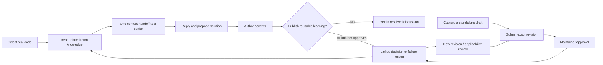

# Combined Smart Context Handoff and Living Engineering Memory

This implementation connects F15 and F07 inside the existing Codebase Mentor application. It keeps one human discussion workflow and one long-term knowledge store. Existing workspace, repository analysis, shared code/architecture views, account roles, handoff links and routes continue to work.

| Capability                      | Responsibility                                                                                                                                  | Existing entry point                                                |
| ------------------------------- | ----------------------------------------------------------------------------------------------------------------------------------------------- | ------------------------------------------------------------------- |
| Smart Context Handoff (F15)     | Ask a senior, share pinned code and diagrams, reply, annotate, request context, propose and accept a solution.                                  | Collaborate → Context Handoffs; Workspace → Create Handoff Snapshot |
| Living Engineering Memory (F07) | Preserve reviewed decisions and failure lessons, approve exact revisions, retain history, review applicability, supersede or withdraw guidance. | Collaborate → Team Knowledge                                        |

Both pages now have the same Handoffs / Team Knowledge tabs. F07 has no second question inbox, reviewer chat or separate identity system. The attached archive was inspected as a reference; its parallel F07 question system and default demo authentication were not copied into the application.

## Example and workflow

A developer asks why signup rejects an existing account. A senior explains the create-only contract and proposes preserving the conflict response. The developer confirms that the answer resolves their question. A maintainer can then select **Design decision** and **Approve for Team Knowledge**.

The result is one decision record linked to the accepted resolution and its original handoff. The entire conversation is not copied into another chat. Repeating the same promotion returns its existing record; it does not create another knowledge entry. A syntax explanation can remain a resolved handoff without publication.



## Capture knowledge without a handoff

1. Analyze the repository using the existing Architecture page.
2. Open Team Knowledge, sign in and choose the correct workspace.
3. Select **Capture knowledge**, then **Design decision** or **Failure lesson**.
4. Enter the engineering explanation and select an actual analyzed source component. The backend supplies the repository, commit and source coordinates; these cannot be invented by the form.
5. Save the draft. It appears under **Include drafts and historical records** and is not returned as approved guidance.
6. The author or maintainer selects **Submit for review**. Only a maintainer can choose **Approve this revision**.

A maintainer may share a newly analyzed public repository into their workspace by creating its first draft. Other members can create drafts for repositories already shared with that workspace. Workspace membership and repository scope are checked on the server.

## Decisions and failure lessons

A decision supports context, decision statement, rationale, constraints, alternatives and consequences. A failure lesson supports a reported failure, environment/reproduction context, suspected or maintainer-reported cause, resolution, verification notes and prevention.

Unknown cause is valid. Resolution verification defaults to **not verified**. Selecting maintainer-reported verification requires a note. A promotion never infers a cause or marks a resolution execution-verified from an accepted reply. Human approval means that an authorized maintainer reviewed the revision; it does not independently prove historical intent, incident causality or a runtime outcome.

These are manually captured, source-linked records. The application does not execute reproductions or automatically import logs, incidents, ADRs or PR comments. Existing human review remains essential.

## Approval, history and applicability

The lifecycle is `draft → awaiting_review → approved`. A relevant source check may mark published knowledge `needs_review`. Maintainers can supersede a record with another approved record in the same workspace/repository or withdraw it. Archived records remain available by their direct link and history.

**Revise knowledge** creates a new draft revision and preserves previous content, evidence and approval metadata. Approval requires the exact expected revision. Concurrent edits cannot overwrite one another. An existing approval never transfers silently to the correction. The editor can retain the original source or explicitly bind the new draft to the selected analyzed version.

The details page compares evidence with a selected version of the same repository. It compares anchored declarations by file/symbol and source fingerprint, using exact AST offsets when available. Unrelated changes outside the declaration do not automatically mark it stale. Missing/ambiguous anchors and incomplete evidence are disclosed as uncertain. Matching declarations do not prove that every dependency or runtime behavior is unchanged.

**Check selected source version** persists a review flag for relevant changes. Merely reading a record does not mutate it, but a detected mismatch makes the applicability warning visible and prevents presenting it as authoritative for that selected version. **Keep historical approval** retains the original evidence; updating the supported source version requires a new reviewed revision.

Reopening a resolved handoff flags its approved linked record for review. Its old approval remains in history. It cannot be restored while the original handoff is unresolved. Revising or withdrawing knowledge does not delete the original accepted conversation.

Previously approved authenticated handoff answers are backfilled once into linked decision records. This is an additive migration, not promotion of demo data. Where an old approval timestamp was not stored, the imported record leaves it unknown rather than inventing one. Immutable shared handoff graphs are preferred when constructing their original evidence. An older handoff with only an immutable selection retains that evidence with incomplete comparison coverage.

## Retrieval in the existing platform

Team Knowledge searches by literal text, type and lifecycle state, with 30 records per page. Default retrieval includes published and review-needed records, with authority/applicability flags. Draft and archived records require an explicit history/draft option. Source-context retrieval uses file/symbol or overlapping evidence ranges; it is not a claim of semantic similarity.

Relevant records appear in the existing code workspace, actual-repository CodeJourney details and the Create Handoff Snapshot form. This lets a developer read an existing explanation before escalating. These are separate approved-knowledge cards: they are not silently injected into the existing Gemini prompt. Automatic semantic deduplication of equivalent open handoffs is not implemented; F15 retains its request-UUID retry protection.

The original `/api/handoffs/knowledge` endpoint remains a compatibility view for approved handoff answers, respecting the linked record's publication state. New UI retrieval and lifecycle actions use `/api/memory`. There is no duplicate F07 question/reply API.

## Actual API and storage

All endpoints below are authenticated. Paths start with `/api/memory`.

| Endpoint                                | Behavior                                                                                                                                        |
| --------------------------------------- | ----------------------------------------------------------------------------------------------------------------------------------------------- |
| `GET /records?workspaceId=...`          | Search published/review-needed knowledge. Optional `q`, `type`, `status`, `snapshotId`, `referenceId`, `repository`, `includeDrafts`, `offset`. |
| `POST /records`                         | Create a decision/failure draft with workspace, actual snapshot/reference IDs and content.                                                      |
| `GET /records/:id`                      | Read a scoped record; optional selected snapshot calculates applicability.                                                                      |
| `GET /records/:id/history`              | Immutable revision content/approval provenance and latest 100 audit events.                                                                     |
| `POST /records/:id/revisions`           | New draft revision; expected revision and optional replacement source evidence.                                                                 |
| `POST /records/:id/submit`              | Submit the exact draft revision.                                                                                                                |
| `POST /records/:id/approve`             | Maintainer approval of an awaiting-review revision.                                                                                             |
| `POST /records/:id/check-applicability` | Compare actual saved source and persist a relevant review flag.                                                                                 |
| `POST /records/:id/review`              | Maintainer historical applicability review with reason.                                                                                         |
| `POST /records/:id/withdraw`            | Audited withdrawal with reason.                                                                                                                 |
| `POST /records/:id/supersede`           | Link an approved same-scope replacement with reason.                                                                                            |

The existing `POST /api/handoffs/:id/approve-knowledge` accepts optional `{ "type": "decision" }` or `{ "type": "failure_lesson" }`. Its existing empty body still means decision. It creates or retrieves the linked record inside the handoff approval transaction. Session details now include `memoryRecords` links.

Three new SQLite tables use the existing connection:

- `engineering_memory`: workspace/repository scope, type, lifecycle, current revision, original session/resolution and replacement links.
- `engineering_memory_revisions`: immutable content and source fingerprints, authenticated author, exact-revision approver and timestamps.
- `engineering_memory_events`: actor, revision, lifecycle action, reason/metadata and timestamp.

Existing source evidence is referenced rather than copied into another repository or discussion system. Revision-content updates are rejected by a database trigger. Writes use the existing immediate transaction helper. Approval identity, authority and status cannot be set through client content fields.

## Code ownership and setup

Backend: `engineeringMemory.js`, `engineeringMemoryRoutes.js`, integration in `handoffRoutes.js` and `server.js`. Frontend: `TeamKnowledge.tsx`, `MemoryEditor`, `CollaborationTabs`, `RelatedTeamKnowledge`, `services/engineeringMemory.ts`, `engineering-memory.css`, plus small integration changes in Handoffs, Workspace, CodeJourney and Create Handoff Snapshot.

No new service, package or environment variable is required. Existing account cookies, workspace roles, SQLite path, public-repository source and optional handoff Gemini settings remain in use. Normal commands:

```powershell
# Backend terminal
cd backend
npm.cmd run dev
# Frontend terminal
cd frontend
npm.cmd run dev
```

Restart an older backend to apply the additive tables and approved-handoff backfill. Both teammates still need the same running backend/database; a localhost link does not connect different computers automatically.

## Verification and remaining scope

`backend/test/engineeringMemory.test.js` covers workspace isolation, no unauthenticated retrieval, server-authorized approval, rejection of client approval identities and fabricated references, draft exclusion, exact revision/history, source comparison, unknown failure causes, idempotent promotion, reopened handoffs, supersession, withdrawal and concurrent corrections. Existing handoff tests continue to pass.

`engineeringMemoryMigration.test.js` also verifies one-time preservation of existing approvals, the original source, the real historical approver, an unknown original approval timestamp and fallback evidence when an old analysis is missing.

The extended `npm.cmd run verify:handoffs` browser check passed developer/senior review, accepted answer promotion, backend restart, standalone failure capture, approval, a new revision with preserved approval history, component-context retrieval and mobile width. It uses a separate test database and actual parser fixtures, not production sample knowledge. No paid provider calls or repository commands run in that check.

Run `npm.cmd test` in backend and frontend and `npm.cmd run build` in frontend. Verification completed with **91 backend tests, 62 frontend tests and the production build passing**. The extended browser check also passed the existing handoff flow, new knowledge lifecycle, workspace/CodeJourney retrieval and mobile layout.

| Implemented                                                                                                                                                               | Partial / deliberately limited                                                                                               | Not implemented                                                                                                                                                                                            |
| ------------------------------------------------------------------------------------------------------------------------------------------------------------------------- | ---------------------------------------------------------------------------------------------------------------------------- | ---------------------------------------------------------------------------------------------------------------------------------------------------------------------------------------------------------- |
| One discussion flow; linked or standalone decision/failure records; authenticated approval; immutable revisions; audit; source applicability checks; contextual retrieval | Source-only change checks, literal search, human-reported failure/verification notes; old incomplete evidence remains marked | Automatic ADR/PR/incident import, runtime cause verification, automatic PR change-event ingestion, semantic question deduplication, vector search, AI drafting of memory records or autonomous publication |
