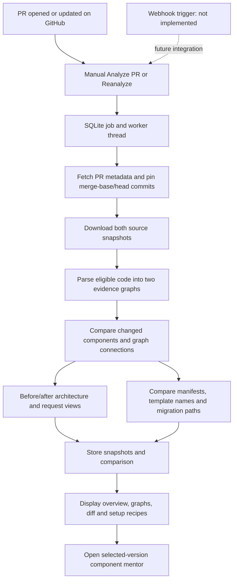

# PR impact and setup guide

Implementation review: 24 October 2026. This guide describes the current code, including the real PR comparison added after the initial demo.

## 1. Purpose and example

The Changes page now automatically lists PRs from the repository already analyzed in Repository and shows actual changed files, source-derived component and connection differences, and setup evidence from both versions. The old example is available only through **View prepared demo**. A failed real analysis never substitutes demo results.

For example, a PR adds email verification to signup. Its diff may add a verification service and a call from signup, change a login guard, add a mail dependency, and add environment-template variable names. The analyzer can show those source facts and incoming connections worth reviewing. It does not establish that an email was delivered or that either version ran successfully. The bundled email-verification example remains synthetic; submitting a real PR uses GitHub instead.

## 2. Complete workflow

1. A developer opens or updates a PR on GitHub. There is no webhook receiver yet.
2. In **Changes**, select a PR fetched from the active analyzed repository and click **Analyze PR**. Open PRs load automatically; closed/merged and all-PR filters, refresh, and pagination are available. After another push, use **Reanalyze**. Each run has a separate job ID.
3. Express validates the URL, stores a job, and starts a bounded Node worker. The browser polls progress.
4. GitHub supplies PR metadata, target/head SHAs, a merge-base commit, and changed-file patches. The common ancestor is the before version; the pinned PR head is the after version. This avoids counting unrelated changes on the target branch as PR changes.
5. A second metadata read rejects a PR whose head or target moved while its comparison metadata was being fetched. Later pushes do not mutate an already captured result.
6. The worker downloads both pinned source archives, runs the existing parser on each, and creates two independent evidence graphs. It analyzes eligible snapshot source, not just changed files, so connected code is available.
7. The comparison matches components, compares their exact source spans, and compares graph connections. It follows incoming connections to identify possible downstream review targets.
8. The worker extracts environment-template names, compares captured package manifests, and flags changed migration-like paths.
9. Both snapshots and the comparison are persisted. The UI displays the comparison tabs and merge simulator and restores the last job after reload.



The request walkthrough is source-derived. It is not a captured runtime trace or a proof of execution order.

## 3. Technology responsibilities

| Technology actually used | Purpose |
| --- | --- |
| GitHub REST API / archives | Read public PR metadata, compare commits, resolve the merge base, obtain patches, and download immutable source. No local Git clone is needed. |
| Git CLI (`git merge-file`) | Optional per-file three-way text integration preview in temporary files; no clone, checkout, hooks, push, or repository scripts. |
| TypeScript Compiler API | Parse JS/TS declarations, imports, supported calls, Express registrations, and exact source spans. |
| SQLite / Node `node:sqlite` | Persist PR jobs, comparisons, both snapshots, source evidence and mentor sessions. |
| Gemini | Existing optional component/project documentation and component discussion. Core PR comparisons and setup recipes are deterministic and do not require or call Gemini. |
| React Flow | Interactive system/service/request diagrams for the selected before or after snapshot. Mermaid is used in this document and existing documentation exports. |
| React / TypeScript / Vite | PR form, polling, five tabs, responsive layouts, patch display, and source/version selection. |
| Node.js 24+ / Express / Zod | API routing, validated requests, job coordination, provider integration and persistence. |
| Node worker threads | Bounded background download and parsing. No target-application execution worker exists. |
| ElevenLabs / browser audio | Optional existing component-discussion transcription and spoken replies; unrelated to computing PR facts. |

## 4. How the parts are implemented

### PR details and comparison commits

`backend/src/prGithub.js` validates `https://github.com/owner/repo/pull/123` URLs and calls GitHub's PR and compare endpoints. Both base and head repositories must be public and available. Head SHA, target SHA and merge-base SHA are retained. Public fork PRs use the head repository for after-source retrieval. Deleted forks, inaccessible commits, API errors and changing PR metadata fail explicitly.

PR discovery loads the repository from a known snapshot ID, verifies public GitHub visibility, and lists PRs sorted by recent updates in 30-item pages (pages 1?100). The backend constructs their URLs, so the browser does not need a PR-link input. With no active analysis or saved comparison, the UI links to Repository first. A saved comparison may supply the repository when no active repository exists. Switching the active repository cancels the old list request; a saved result from another repository is labelled separately.

GitHub's compare response is bounded to its available file list; 300 returned files, or fewer files than the PR metadata reports, marks the result incomplete. It does not paginate an unlimited repository history or pretend to have every patch.

### Changed files and functions

`prComparison.js` consumes GitHub's changed paths and the two parser outputs. A component key combines canonical file path, role and name; GitHub-reported file renames map the old path to the new path. Module keys use the canonical path. Raw sequential component IDs are never equated across snapshots.

Changed components are added, removed or modified. Exact AST offsets select full declaration text, so changes after the 1,800-character reference excerpt and separate functions on one line are compared correctly. Duplicate-name matches are labelled ambiguous and treated conservatively as additions/removals. Anonymous functions whose names include line numbers can shift identity; symbol renames and semantic equivalence are not inferred.

### Connected components and possible impact

Connections are compared using the matched endpoint keys, relationship type and mount path. Added and removed edges retain source references. Incoming relationships from changed components are followed for up to three hops, with at most 150 reported components per version. These are possible review targets, not detected bugs. Missing or dynamic connections limit coverage.

### Before/after architecture

The Architecture tab loads both stored snapshots and reuses `BackendArchitecture.tsx`. Before/After buttons select the commit to render; system, service and request modes reuse the existing React Flow layout and edges. Added/removed connection counts come from graph comparison. The view switches versions rather than presenting a new overlaid delta graph.

### Visual walkthrough

Journey comparison uses the existing request-path explorer against each real snapshot. Users select a version and supported route to follow source-derived connections. Unsupported frameworks or unresolved routes may have no request walkthrough. There is no AI-authored semantic journey-difference narrative and no runtime trace.

### Diagram selection and code differences

The Changed files tab renders GitHub's unified patches with separate before/after line numbers, additions/removals and hunk headers. It indicates missing or truncated patches. Selecting a file lists its changed components; these open the selected-version discussion and an exact commit/line source link. Architecture selections can open the same mentor. Source links use the old path for a renamed file's before version.

Automatic graph-selection-to-highlighted-diff-hunk alignment is not implemented. Sensitive/environment-file patches are suppressed; their values are not persisted in the comparison.

### Setup changes

Environment findings contain only added/removed assignment names from `.env.example`, `.env.sample` and `.env.template` patch lines. A changed assignment may appear on both sides. This is not a complete dotenv parser or a detector of every environment-variable usage; requiredness is unknown. Local environment files are not inspected.

Captured `package.json` files are parsed and string-valued dependency sections and scripts are compared. Invalid manifests are reported. New, removed and changed versions retain manifest path and dependency section. Lockfiles and transitive dependency resolution are not compared.

Changed migration-folder or SQL-file paths are flagged as potential migrations. Their SQL effects are not inferred and custom migration systems may be missed.

### Version-specific startup guide

Setup & run guide now scans each entire captured source version, not just PR manifest/template differences. `setupRequirements.js` uses TypeScript AST nodes to find direct process.env / import.meta.env / Bun.env reads, static destructuring, missing-value throw guards, fallback expressions, supported service-client construction/connection calls, and listener ports. It assigns findings to the closest captured package manifest and supplies commit-pinned evidence links. Comments and strings are not treated as environment reads. Runtime-requiredness is not inferred from a plain read, and services may only be used on certain paths.

The new `SourceSetupGuide.tsx` groups instructions by app folder: configure environment, prepare detected services, then copy install/start commands. It distinguishes server credentials from public frontend configuration and shows only safe loopback endpoint or port defaults from source; arbitrary fallback strings and secret values are not returned. Dotenv calls, explicit supported env-file flags, and Vite identify conventional loading locations; dynamic loader locations remain unknown. Supported service rules include PostgreSQL, MongoDB, Redis, Docker clients, Prisma, S3, and AWS CodeBuild. Dependencies alone do not establish a service requirement. AWS SDK credential/profile/role instructions are labelled service conventions, not additional source-detected environment reads.

Package-manager declarations and pinned lockfile paths establish install commands. npm uses npm ci when its lockfile is present. Declared dev/start/serve scripts supply startup commands; compiled start scripts can require the declared build script first. Runtime versions come from declared engines; runtime version-file paths link to source when present. An unknown manager is shown explicitly and requires a user selection before suggested install/start commands are offered. Commands can be copied for PowerShell or macOS/Linux. A service account, database name, missing start script, or unknown version is never fabricated.

`setupPlans.js` loads saved source and path-only setup metadata. Older comparisons can gain setup guides without reanalysis: missing metadata is fetched from their exact GitHub tree and cached. Metadata failures leave available source requirements visible with a coverage warning. Before/After switches use their own snapshots. Raw PR setup deltas and original manifests remain in a collapsed details section. Nothing is installed, started, migrated or execution-verified, and this is not a new Gemini generation endpoint.

### Existing component mentor

Selecting a component opens `ComponentDiscussion` in a dialog. Before/After controls select the matched component when one exists; added/removed components may only exist on one side. The mentor uses one selected snapshot at a time. Changing its binding preserves the old conversation and requires an explicit new discussion. Combined two-version AI context remains unfinished. Existing text, live voice, citation and decision-record controls are reused.

### PR merge simulator

The **Merge simulator** tab uses `mergeSimulator.js` and `PRMergeSimulator.tsx`. Select a changed file, then **Simulate integration**. It compares common-ancestor text, the captured target-branch version, and PR-head text. Independent changes are combined; overlaps retain diff3 conflict markers. Add/add and modify/delete cases require explicit review. Fast paths handle identical or unchanged sides. For overlapping version changes, Git must be installed on the backend PATH. The Git command uses fixed argument arrays and bounded temporary files under ignored `backend/data/merge-simulations/`; temporary directories are checked and cleaned up afterward. No repository commands, merge drivers, hooks, or project code execute.

Sources come from saved snapshots where possible, otherwise known changed paths at pinned GitHub commits. Each text input is limited to 256 KB; binary, sensitive and renamed paths are rejected. Two simulations may run concurrently and each Git invocation has a ten-second timeout. This is a per-file text preview, not a full Git tree merge: rename/tree conflicts, custom attributes, cross-file incompatibilities and runtime behavior are not simulated. A clean text result is not a safe-to-merge verdict.

Users can switch source views, edit a local draft, explicitly choose either side for review, reset the draft, or download preview JSON with its commit IDs. Drafts persist across file/tab changes within the current loaded comparison, but are not saved to SQLite or applied to the repository. Reloading or analyzing a new comparison discards them. Download important drafts first.

## 5. Data storage and evidence identity

`prRoutes.js` creates two new tables:

| Table | Stored fields |
| --- | --- |
| `pr_jobs` | `id`, `status`, `progress`, `message`, `comparison_id`, `created_at`, original PR `url` (nullable for older jobs) |
| `pr_comparisons` | `id`, `base_snapshot_id`, `head_snapshot_id`, comparison JSON in `data` |

Comparison JSON contains PR metadata/SHAs, file patches with sensitive content removed, component deltas, connection deltas, possible impact, setup findings and limitations.

The existing tables remain in use:

| Tables | Responsibility |
| --- | --- |
| `repositories`, `snapshots` | Repository URL, commit SHA and graph JSON for each pinned version. |
| `components`, `relationships`, `source_references` | Snapshot-scoped entities and their source evidence. |
| `snapshot_setup_metadata` | Snapshot ID and path-only setup metadata (lockfiles, templates, runtime/schema/compose paths and coverage). Environment-file contents are not captured. |
| `source_files` | Full eligible source and selected manifest/README text keyed by snapshot/path. |
| `analysis_jobs` | Existing independent single-repository analysis jobs; distinct from `pr_jobs`. |
| `documentation`, `generated_guides` | Snapshot facts/Markdown and optional validated generated guides. |
| `discussions`, `discussion_messages`, `discussion_decisions` | Single-version mentor sessions, history and explicitly saved decision records. |

The browser stores `mentor-pr-job`. That job points to a comparison ID; the comparison points to before/after snapshot IDs. Each component delta includes its side-specific component ID and source reference. A source reference binds file, line range, AST offsets, snapshot and commit-pinned URL.

Snapshot IDs are derived from repository URL plus commit. Components such as `c0` are only unique within their snapshot. Always use `(snapshotId, componentId)` together; cross-version matching uses the explicit file/role/name rules rather than those IDs.

## 6. Actual APIs and code organization

| Endpoint | Input → output | Responsible modules |
| --- | --- | --- |
| `GET /api/pr/pulls?snapshotId=...&state=open&page=1` | Known repository snapshot, optional open/closed/all filter and page ? PR list and `hasMore` | `prRoutes.js`, `prGithub.js` |
| `POST /api/pr/analyses` | `{url}` → HTTP 202 `{id}` | `prRoutes.js`, `prWorker.js`, `prGithub.js` |
| `GET /api/pr/analyses/:id` | Job ID → status, progress, message, `comparison_id`, creation time | `prRoutes.js` |
| `GET /api/pr/comparisons/:id` | Comparison ID → saved comparison JSON | `prRoutes.js`, `prComparison.js` |
| `POST /api/pr/comparisons/:id/simulate` | `{path}` from this comparison ? pinned ancestor/target/PR text, result, conflict status and limitations | `prRoutes.js`, `mergeSimulator.js` |
| `GET /api/pr/comparisons/:id/setup` | Comparison ID ? both versions? source-derived projects, env/service requirements, commands, evidence and requirement deltas | `setupPlans.js`, `setupRequirements.js`, `prRoutes.js` |
| `GET /api/snapshots/:id` | Snapshot ID → graph and documentation | `server.js`, `storage.js` |
| `GET /api/snapshots/:id/source?referenceId=...` | Known reference → pinned full source | `workspace.js` |
| `POST /api/snapshots/:id/generated-documentation` | `{componentId?, scope?}` → optional generated sections/citations | `generatedGuides.js` |
| `POST /api/discussions` | `{snapshotId, componentId}` → single-version session | `discussionRoutes.js`, `discussion.js` |
| `GET /api/discussions/:id` | Session ID → history, draft, saved decisions | `discussion.js` |
| `POST /api/discussions/:id/messages` | `{question}` → structured answer and citations | `discussion.js` |
| `GET /api/discussions/:id/evidence/:referenceId` | Allowed reference → scoped evidence | `discussion.js` |
| `POST /api/discussions/:id/draft` | `{chosenOption?}` → editable decision draft | `discussion.js` |
| `POST /api/discussions/:id/decisions` | `{draftId, content}` → saved decision ID | `discussion.js` |
| `GET /api/discussions/config`, `GET /api/discussions/voices` | Configuration flags or actual account voices | `discussionRoutes.js`, `discussionVoice.js` |
| `POST /api/discussions/:id/transcription` | Audio body/content type/duration header → text | `discussionVoice.js` |
| `POST /api/discussions/:id/speech` | `{voiceId, messageId?, preview?}` → audio | `discussionVoice.js` |

Example; the response ID is illustrative:

```http
POST /api/pr/analyses
Content-Type: application/json

{"url":"https://github.com/heroku/nodejs-getting-started/pull/419"}
```

```http
HTTP/1.1 202 Accepted
Content-Type: application/json

{"id":"6e7b3af0-6f78-461e-9eaf-2b10b3ee7676"}
```

Poll the job endpoint. On `complete`, use `comparison_id` to load the result, then fetch its two snapshots. Unknown jobs/results return 404. Invalid URLs return 400. Failed jobs retain their error. Two PR jobs may run concurrently, each limited to five minutes and a 512 MB worker heap. Restarts mark interrupted PR jobs failed. Their original PR URL is retained for an explicit retry. The frontend presents a recovery prompt and removes the interrupted job from its saved pointer, rather than restoring the same error on every reload. Legacy jobs without a stored URL can retry the currently selected PR. Jobs are not automatically resumed or marked successful.

Frontend files: `components/PullRequestChanges.tsx` implements the live form, polling, tabs, diff and mentor; `styles/pr-comparison.css` styles it. `pages/Changes.tsx` makes it the default and retains the prepared demo behind an explicit button. Existing `BackendArchitecture.tsx`, `ComponentDiscussion.tsx`, `analyzer.js`, `github.js`, and `storage.js` supply reusable graph, discussion, parsing, download and persistence logic. No webhook endpoint is implemented.

## 7. AI versus deterministic facts

GitHub supplies metadata, SHAs, changed files and patches. TypeScript parsing supplies declarations and relationships. Component, graph, package and template-name comparisons are deterministic. PR workers skip optional Gemini commentary to keep evidence generation independent of provider availability.

Gemini is used only when existing generated documentation or component discussion is requested. The backend supplies bounded evidence and validates structured replies with Zod. Cited IDs must belong to the supplied snapshot/component context. The server constructs source links; the model cannot invent paths/commit links as citations. Citation membership does not prove that an explanation is semantically correct.

Unresolved analysis appears in parser reports and limitations. Missing patches, invalid manifests, unsupported source and incomplete file lists are shown explicitly. Provider errors produce warnings rather than fabricated answers. Local code drafts are not part of the analyzed PR evidence.

## 8. UI walkthrough

1. **Overview:** see the actual PR title/state, common-ancestor/head commits, changed file/component counts, added/removed connections and possible incoming impact. Select a component to discuss its source. The result is a captured version, not an automatically refreshing live feed.
2. **Architecture:** switch Before/After, then explore system, service or request views. These are actual parsed snapshot graphs, not a semantic delta overlay.
3. **Journey comparison:** explore supported request paths separately on each version. Dynamic behavior and unsupported routes may be absent.
4. **Changed files & diff:** choose a real changed file, read GitHub's unified patch and line numbers, follow pinned source links and inspect changed components. Missing/sensitive patches are explained.
5. **Setup & run guide:** read per-app source-derived requirements and setup steps, configure environment names, prepare detected service clients, and copy lockfile/script-grounded commands. Switch Before/After or shell format. Raw PR deltas and manifests are collapsed below the full setup guide. No command is run by this page.

6. **Merge simulator:** choose one changed file and simulate integration. Review the old target, incoming PR, common ancestor and integrated result. Conflict choices/edits are local drafts, not applied changes.

**Reanalyze** creates a fresh job for a newer PR state. **Export evidence** downloads the stored comparison JSON. Reload restores the most recent PR job. **View prepared demo** remains explicitly separate from these real results. Demo repository chrome and fixture counts are suppressed on Changes.

## 9. Setup and verification

### Configuration and startup

Node.js 24+ is required. Environment names only: `PORT`, `DATABASE_PATH`, optional `GITHUB_TOKEN`, `LLM_API_KEY`, `LLM_MODEL`, `LLM_BASE_URL`, optional `ELEVENLABS_API_KEY`, `ELEVENLABS_STT_MODEL`, `ELEVENLABS_TTS_MODEL`.

Real PR comparison needs GitHub network access, not a model key. A GitHub token can improve API quotas but does not enable private repositories in this feature. Gemini/ElevenLabs credentials are only needed for their optional existing features. Keep actual credentials in ignored `backend/.env`; do not commit them or put them in the frontend.

Two terminals, starting at the repository root:

```powershell
cd backend
npm.cmd install
if (-not (Test-Path .env)) { New-Item -ItemType File .env | Out-Null }
# Configure local environment names as needed without overwriting existing keys.
npm.cmd run dev
```

```powershell
cd frontend
npm.cmd install
npm.cmd run dev
```

Visit `http://127.0.0.1:5173/#/changes`. Vite proxies `/api` to port 3001. Restart the backend after changing configuration or adding the new PR routes. Build frontend assets with `npm.cmd run build`; `npm.cmd start` in backend serves the existing build locally.

No webhook is configurable yet. Do not send GitHub webhook payloads to the manual analysis endpoint: it does not process events or verify signatures. No target-project setup/execution worker exists.

### Automated checks performed

- Backend tests cover PR URL validation, exact-span comparisons beyond excerpt limits, same-line functions, file renames, incoming impact, graph differences, dependency/script findings, invalid manifests, environment-value suppression, and PR updates during metadata reads, alongside existing analyzer/mentor tests.
- Final checks passed: **61 backend tests**, **56 frontend tests**, and `npm.cmd run build` in frontend (TypeScript checking and Vite production bundling).
- `npm.cmd run verify:pr` performed a real read-only GitHub analysis of Heroku PR #419. It verified two changed files, the EJS dependency update, distinct pinned commits, persisted full source and a correctly bound component discussion. It uses a separate database under ignored `backend/data/` and makes no AI calls.
- `npm.cmd run verify:pr-ui` checked the saved real PR in Chrome: automatic PR discovery from a persisted analyzed repository, closed/merged filtering and selection without a URL input, all five tabs, before/after graphs, actual package diff, dependency setup finding, reload persistence and mobile width. Paid providers are disabled in this UI check. The latest browser run uses captured PR-list test metadata to avoid GitHub rate quotas while calling the actual simulator with persisted real PR source; it verified integrated text, old-code view and draft editing. Unit tests also use actual Git for independent and conflicting edits, plus pinned-source, cancellation and input-boundary cases. A screenshot is saved under ignored `backend/data/ui-pr-comparison.png`.

Run `verify:pr` before `verify:pr-ui`; the latter requires local Chrome/Edge and uses the saved verification job. `VERIFY_PR_URL` can override the live verification PR, but its dependency-change assertion expects a PR containing a package dependency change.

Setup-specific checks cover real AST environment reads versus strings/comments, default-secret suppression, safe loopback defaults, frontend/public configuration, manager/lockfile selection, invalid manifests, exact source links, supported service clients including CodeBuild, custom/dynamic dotenv paths, pinned metadata caching and failure handling, and both-version requirement differences. The browser check verified copyable npm install/start commands, shell and version switching, and responsive setup layout. The saved user PR was separately checked read-only: its backend uses AWS CodeBuild and source environment names, its frontend references VITE_API_BASE_URL and VITE_BUILD_API_URL, and both captured app folders have npm lockfiles supporting npm ci. No cloud build or application startup was performed.

### Manual verification

The saved browser screenshot was visually inspected. No manual target-application startup, database migration, email delivery, webhook, or both-version AI conversation was verified. Provider-free browser tests do not establish Gemini or ElevenLabs availability.

## 10. Limitations and status

A source-derived walkthrough is **not a runtime trace**. Possible impact **does not prove a bug**, predict every caller, or establish merge safety. A setup recipe is **not execution-verified** unless its commands were actually run and results recorded; that execution feature is absent.

JS/TS parsing supports a bounded subset of static code and Express conventions. Each snapshot retains existing limits: 200 eligible files, 256 KB per file, 5 MB selected contents, and bounded archives. Sensitive/generated/dependency paths are excluded. Package/schema frameworks outside explicit rules may remain unresolved. A limited changed-file list or missing source means partial coverage, not no impact. GitHub may omit binary/large patches. Public forks must still be available. The service remains local without hosted multi-user access control.

| Implemented | Partially implemented | Not implemented |
| --- | --- | --- |
| Manual public-PR import, pinned comparisons, worker progress, persistence and reload | GitHub's bounded changed-file/patch coverage | Signed webhook processing and automatic PR event updates |
| Named component/source and graph-connection deltas; incoming impact | Heuristic identity matching; separate before/after architecture/request views | Semantic symbol matching, delta-overlay diagram, runtime tracing |
| Actual patches and exact source evidence | File/component selection and per-version discussion | Automatic graph-to-diff-hunk highlighting and combined two-version mentor context |
| Direct manifest/script deltas, template names, migration-path flags and per-version recipes | Requiredness, custom migrations and unsupported setup formats remain unknown | Target dependency installation, migration execution, execution-verified setup and merge-safety verdicts |
