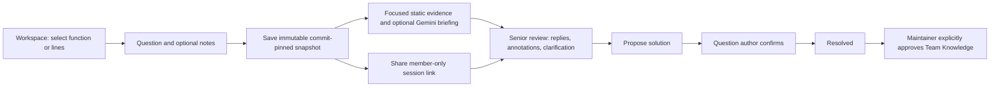

# Smart Context Handoff — implementation and setup

Implemented in the existing Codebase Mentor application on 24 October 2026.

Smart Context Handoff now connects to **Living Engineering Memory** through the shared Handoffs / Team Knowledge tabs. Accepted answers can become linked decisions or failure lessons; standalone records, exact-revision approval, history and source applicability checks are also available. See [the combined workflow guide](collaboration-and-engineering-memory.md) for the current knowledge lifecycle and APIs. The handoff/source-sharing behavior below remains in place.

## What it does

A developer can ask a human teammate a focused question about repository code. The handoff saves the original source, its exact commit, the question, debugging notes, a focused evidence graph, and an optional Gemini briefing. The shared review also includes complete captured source files, a searchable file/component explorer, and architecture diagrams from the same commit. The selected lines remain highlighted while the reviewer reads surrounding code. A senior reviewer can reply, annotate the original lines, request clarification, and propose a solution. Every question has a separate database-backed conversation.

For example, select the conflict check in `createUser`, ask “Why reject an existing email instead of updating the account?”, and send the session link to an invited reviewer. The reviewer can comment on the throwing line, explain the create-only contract, and propose keeping the conflict response. The question author must confirm the solution. A maintainer can then approve that explanation for Team Knowledge.



## Start locally

Use Node.js 24 or later. From two terminals:

```powershell
cd backend
npm.cmd install
npm.cmd run dev
```

```powershell
cd frontend
npm.cmd install
npm.cmd run dev
```

Open the frontend URL printed by Vite. The frontend proxies API requests to the existing backend on port 3001. A built frontend is also served by the backend when `frontend/dist` exists.

No external service key is needed for human questions, answers, annotations, or resolutions. For the optional briefing, configure these **names only** in `backend/.env`:

| Variable        | Purpose                                                                                                        |
| --------------- | -------------------------------------------------------------------------------------------------------------- |
| `LLM_API_KEY`   | Server-side key for the existing Gemini-compatible adapter.                                                    |
| `LLM_BASE_URL`  | Optional compatible endpoint override. Uses the existing project default.                                      |
| `LLM_MODEL`     | Optional model override. Uses the existing project default.                                                    |
| `DATABASE_PATH` | Optional SQLite file path. Default: `backend/data/mentor.sqlite`.                                              |
| `PORT`          | Optional backend port. Default: 3001. Adjust the development proxy if changing it.                             |
| `APP_ORIGIN`    | Additional allowed frontend origin for a deployed frontend. Include scheme and port, without a trailing slash. |
| `NODE_ENV`      | Set to `production` for HTTPS deployment; authentication cookies then require HTTPS.                           |

The schema migration runs automatically when the backend starts. Back up the SQLite database before deploying schema changes. Existing repository analysis, PR comparisons, source files, and voice discussions are preserved.

Both teammates must use the **same running backend and database**. The existing server binds to loopback. To share between computers, deploy it behind an HTTPS reverse proxy on a shared host; a link to your own `localhost` is not reachable by another computer. Use one frontend origin for registration, login, and session links because cookies are host-specific.

## Use it

1. Open **Collaborate → Context Handoffs** and create an account. This creates your workspace and gives you its maintainer role. Alternatively, open a teammate’s invitation to join their workspace.
2. In **Team access**, a maintainer can create a one-time **Senior / reviewer** or **Developer** invitation. It expires after seven days. Send it privately yourself. The application does not send Slack, Teams, or email messages.
3. Analyze a public repository with the existing Architecture page. Open **Workspace** and choose a component. Its source range is preselected. Click a line number to select one line; Shift-click another to select a range.
4. Choose **Create Handoff Snapshot**. Review the file and commit, adjust the range if needed, enter a title and question, and optionally add debugging attempts, expected behavior, actual behavior, and a reviewer assignment.
5. Create the handoff and copy its link. The save uses the backend’s original analyzed source. Local editor drafts and unrelated AI chat are excluded. Select at most 300 lines and 18,000 characters.
6. The reviewer signs in as an invited workspace member. They see the complete saved file with the original selection highlighted, the question, and an optional AI briefing. The explorer opens other captured files and their components. **Code**, **Split**, and **Architecture** switch between source and diagrams. The diagram selector offers component connections, backend architecture, request flow and services/logic. **Original shared selection** returns to the question's code. Click a highlighted line number and post a reply to annotate it. Other files can be discussed in normal replies; annotations stay scoped to the original range.
7. Both participants can reply. Reviewers can mark **Request more context**, which records a clarification request and changes the status to `NEEDS_CONTEXT`. Refresh retrieves teammates’ latest replies; this version does not push live updates.
8. A reviewer other than the question author can **Propose a solution**, including an explanation. The author chooses **This solved my question** to resolve the session. AI generation never resolves a question.
9. A maintainer explicitly chooses **Approve for Team Knowledge**. Approved answers appear in the searchable Team Knowledge page with their original commit and discussion. A different selected commit receives a version warning. Reopening a resolved handoff withdraws its knowledge approval and requires a new proposal and confirmation before publication again.

The session list supports title/question search, repository and status filters, My Sessions, Assigned to Me, Open, and Resolved. It sorts by recent activity, with 30 sessions per page. Conversations are chronological, with 50 replies per page. More replies can be loaded. The activity panel shows the latest 50 events.

## How the shared code and architecture view was built

1. **Reuse the analyzed commit.** The handoff records an analysis snapshot ID and full commit SHA. `handoffRepository.js` reads that graph and its stored `source_files`, rather than the repository currently open in another tab.
2. **Freeze complete source once.** Creation saves one immutable repository view per analysis snapshot and its available analyzed files. Multiple handoffs from that commit reuse this copy. Sensitive paths are excluded; common credential values in supporting source are omitted while preserving line counts. Database triggers reject updates to the graph and files. The original selection remains separately immutable.
3. **Support existing shared links.** An older handoff builds its explorer from its own stored analysis and commit when opened. No reanalysis or external fetch is triggered. If the full source is unavailable or disagrees with the original selection, the selected excerpt stays visible with an explanation.
4. **Serve authorized requests.** The repository index returns the saved graph and file list. A separate endpoint returns one captured file at a time after checking handoff membership. Arbitrary paths, another repository and another commit cannot be requested through it.
5. **Build the explorer.** `HandoffRepositoryBrowser.tsx` reuses `workspaceFileTree` for expandable folders and recorded references for function entries. Selecting a file loads its complete text; selecting a function jumps to its range. Search matches paths or component names.
6. **Highlight the question's code.** The existing Prism `RepositorySource` renders complete files starting at line 1. Its primary highlight marks the original shared range. Separate navigation and review ranges let a reviewer inspect another function without erasing that highlight. Copy and Expand work on the displayed complete file.
7. **Reuse architecture tools.** `WorkspaceConnectionMap` shows callers and dependencies. `BackendArchitecture` shows backend, request and service views from the frozen graph. Clicking a component opens its source. Gemini does not invent these diagrams. Unsupported patterns retain the existing empty state.
8. **Remove the empty vertical gap.** The left column stacks the shared workspace and conversation. The right independently stacks the question/briefing and resolution. A long briefing cannot push the conversation below an empty area under the code. Smaller screens stack the columns and bound the explorer's height.

“Complete source” means the files captured by the existing JavaScript/TypeScript analysis, not an unrestricted copy of every GitHub file. The coverage control shows counts and unavailable paths. Existing analysis limits, excluded files and unsupported languages still apply. This expansion does not send the full repository to Gemini; briefings continue to use focused evidence.

## Existing services reused

| Part                                 | Implementation                                                                                                                                                          |
| ------------------------------------ | ----------------------------------------------------------------------------------------------------------------------------------------------------------------------- |
| Repository and commit selection      | Existing public GitHub analyzer and stored `snapshots`.                                                                                                                 |
| Full source                          | Existing `readSource` for creation; `handoffRepository.js` freezes analyzed files and serves complete source through handoff-authorized endpoints.                      |
| Function detection and relationships | Existing TypeScript AST components, references, and `questionContext` evidence graph. The smallest containing component identifies the selected function when possible. |
| Existing documentation               | Cached component guides from `generated_guides`, when available.                                                                                                        |
| AI                                   | Existing Gemini-compatible environment configuration and bounded HTTP client; new structured handoff briefing validator.                                                |
| Code viewing                         | Existing Prism `RepositorySource`, extended with keyboard-accessible line selection and annotation indicators.                                                          |
| UI and routing                       | Existing Radix modal, Buttons, Badges, React Router hash navigation, and light purple theme.                                                                            |
| Persistence                          | Existing SQLite connection, additive tables and startup migration.                                                                                                      |

The sidebar now groups Explore, Learn, Changes, Collaborate, and AI Mentor; Context Handoffs appears only under Collaborate. Architecture, documentation, PR setup, and voice links open existing features. Agent Context Bridge and the original prepared knowledge demo remain available through Settings & Integrations.

## Files and modules

| Area                                | Files                                                                                                                                                                                                                                                                                            |
| ----------------------------------- | ------------------------------------------------------------------------------------------------------------------------------------------------------------------------------------------------------------------------------------------------------------------------------------------------ |
| New backend implementation          | `backend/src/collaborationAuth.js`, `handoffStorage.js`, `handoffRoutes.js`, `handoffContext.js`, `handoffSafety.js`, `handoffRepository.js`                                                                                                                                                     |
| New frontend implementation         | `frontend/src/pages/Handoffs.tsx`, `TeamKnowledge.tsx`; `components/HandoffRepositoryBrowser.tsx`, `components/CreateHandoffModal.tsx`, `HandoffAccount.tsx`, `MentorNavigation.tsx`; `state/CollaborationContext.tsx`; `services/handoffApi.ts`; `styles/handoffs.css`, `mentor-navigation.css` |
| New verification                    | `backend/test/handoffs.test.js`, `backend/scripts/handoff-test-server.js`, `backend/scripts/verify-handoffs-ui.js`                                                                                                                                                                               |
| Existing integration points updated | `backend/src/server.js`, `github.js`, `analyzer.js`; `frontend/src/App.tsx`, `components/Shell.tsx`, `LiveMentorWorkspace.tsx`, `RepositorySource.tsx`, `PullRequestChanges.tsx`, `pages/Repository.tsx`, `domain/analysisTypes.ts`; `backend/package.json`, `README.md`                         |

The source-derived setup-guide work already present in the working tree was preserved while updating and integrating this feature.

## Authentication and permissions

There was no team authentication system in the original application. `collaborationAuth.js` adds local accounts with salted scrypt password hashes, random session tokens stored only as hashes, HttpOnly/SameSite Strict cookies, and a sign-in attempt limit. Authentication lasts seven days. Sign-out revokes the stored token. Invitation tokens are random, stored as hashes, expire, and can be used once. Invite links are carried in the frontend URL fragment.

Every handoff endpoint checks authentication. Session reads and writes check workspace membership and the workspace’s shared repository record. All workspace members can access all repositories shared with that workspace; use separate workspaces for different access boundaries. A session link alone grants no membership. Reviewer and maintainer actions are checked on the backend, independently of UI visibility. Assignments must reference a reviewer in the same workspace.

Only maintainers invite teammates or approve knowledge. Developers can post questions and replies. Reviewers and maintainers can request context and propose solutions. A reviewer cannot propose a solution to their own question. Only the original question author can accept a proposal. Resolved or closed conversations must be reopened before adding review content.

The existing public repository analysis APIs remain local, public-source tools; this change does not enable private GitHub ingestion or claim application-wide authentication. Handoff discussions and their saved snapshots are separately protected.

## Storage and evidence identity

`handoffStorage.js` creates these tables using idempotent SQL:

| Table                         | Stored data                                                                                                                                     |
| ----------------------------- | ----------------------------------------------------------------------------------------------------------------------------------------------- |
| `collaboration_users`         | User ID, display name, email identifier, salted password hash.                                                                                  |
| `collaboration_workspaces`    | Workspace ID and name.                                                                                                                          |
| `collaboration_members`       | Workspace/user membership and server-enforced role.                                                                                             |
| `collaboration_auth_sessions` | Hashed session token, user ID, expiry.                                                                                                          |
| `collaboration_invites`       | Hashed one-time token, workspace, invited role, expiry, usage.                                                                                  |
| `collaboration_repositories`  | Repository URLs explicitly shared into a workspace. Existing repository IDs are URLs.                                                           |
| `handoff_sessions`            | Question, title, notes, author, assignment, lifecycle and timestamps.                                                                           |
| `handoff_snapshots`           | Original selected code, file/range, branch when known, full commit, analysis snapshot/component/reference IDs, focused context and AI briefing. |
| `handoff_repository_views`    | Immutable analyzed graph and coverage metadata, keyed by analysis snapshot ID.                                                                  |
| `handoff_repository_files`    | Complete captured source with credential filtering; reused by handoffs at the same analysis snapshot.                                           |
| `handoff_comments`            | Session, snapshot, author, reply, optional original line range, comment/request type, timestamp.                                                |
| `handoff_activity`            | Actor, event type, metadata, timestamp.                                                                                                         |
| `handoff_resolutions`         | Reviewer proposal and explanation, author confirmation, maintainer knowledge approval.                                                          |

Session creation and lifecycle changes use transactions. Session and comment indexes support workspace activity and conversation pagination. A database trigger prevents updates to snapshot source coordinates, code, and captured context. The AI-summary field can be updated without changing the source.

The UI route contains a random session UUID. The session links to one immutable handoff snapshot; that snapshot records the original analysis snapshot ID, component ID, reference ID, and full commit. Component IDs only have meaning inside their recorded analysis snapshot. Comments link to the handoff snapshot ID and its original lines. Source URLs are constructed by the backend from pinned evidence, never supplied by Gemini.

## Actual APIs

All paths below start with `/api`. Request bodies are validated with Zod. Errors use `{ "error": "message" }` with an HTTP status. Protected data is never returned merely because an ID exists.

| Method and path                              | Input → output                                                                                                                  |
| -------------------------------------------- | ------------------------------------------------------------------------------------------------------------------------------- |
| `POST /collaboration/register`               | Name, email, password; optional invitation → user and session cookie. Without an invitation, creates a workspace.               |
| `POST /collaboration/login`                  | Email and password → user and session cookie.                                                                                   |
| `GET /collaboration/me`                      | Cookie → signed-in user and memberships.                                                                                        |
| `POST /collaboration/logout`                 | Cookie → revocation and `{ok:true}`.                                                                                            |
| `POST /collaboration/accept-invite`          | Token → join workspace.                                                                                                         |
| `GET /collaboration/workspaces/:id/members`  | Member access → member names, IDs, email identifiers and roles.                                                                 |
| `POST /collaboration/workspaces/:id/invites` | Maintainer, role → one-time token and expiry.                                                                                   |
| `POST /handoffs`                             | Workspace, analysis snapshot/reference, range, title, question, optional notes/assignment, request UUID → saved session detail. |
| `GET /handoffs`                              | `workspaceId`, optional `search`, `repository`, `status`, `filter`, `offset` → sessions, total, repository choices.             |
| `GET /handoffs/:id`                          | Member access → session, snapshot/evidence, first comment page, proposals, activity, viewer role.                               |
| `GET /handoffs/:id/repository`               | Member access returns saved graph, captured file list and coverage.                                                             |
| `GET /handoffs/:id/repository/source`        | Member access and exact captured `path` returns complete saved file with original line numbers and pinned commit.               |
| `PATCH /handoffs/:id`                        | Author/maintainer; optional title and reviewer assignment → updated detail. Original question/source are preserved.             |
| `GET /handoffs/:id/comments`                 | Optional `offset` → chronological comment page.                                                                                 |
| `POST /handoffs/:id/comments`                | Content, optional line range, `comment` or reviewer-only `context_request` → updated detail.                                    |
| `POST /handoffs/:id/context`                 | Member access → optional AI briefing, reusing successful saved results and concurrent generation.                               |
| `PATCH /handoffs/:id/status`                 | Permitted transition to OPEN, IN_REVIEW, NEEDS_CONTEXT or CLOSED → updated detail. RESOLVED requires confirmation.              |
| `POST /handoffs/:id/resolution`              | Reviewer solution and explanation → proposal and updated detail.                                                                |
| `POST /handoffs/:id/confirm-resolution`      | Author, latest proposal ID → RESOLVED detail.                                                                                   |
| `POST /handoffs/:id/approve-knowledge`       | Maintainer, confirmed resolved session → explicit knowledge approval.                                                           |
| `POST /handoffs/:id/share`                   | Member access → frontend path and access description; does not grant access.                                                    |
| `GET /handoffs/knowledge`                    | Workspace, optional search/offset → approved version-specific explanations.                                                     |

Creation uses a client-generated random `requestId`. Retrying that request returns the same session rather than creating duplicates. A fresh creation uses a fresh ID.

Example annotation request, after signing in:

```http
POST /api/handoffs/<session-uuid>/comments
Content-Type: application/json

{"content":"This condition rejects an existing account.","lineStart":44}
```

The response contains updated session details and the saved comment, including its author, handoff snapshot ID, original line 44, and timestamp. A range outside the original snapshot is rejected.

## AI boundaries

Commit, source, line numbers, detected function names, and resolved relationships come from stored analysis. Gemini writes a purpose summary, cited findings, possible explanations, unresolved questions, and suggested review areas. It receives the selected code, bounded one-hop relationships/imports and relevant cached documentation. Only tests linked into this focused evidence are included; test discovery is not exhaustive. Unrelated mentor conversation is never included.

Repository text and developer notes are treated as untrusted content in the prompt. Zod validates the result; factual sections must cite `selection` or reference IDs supplied in this context. Unknown IDs and model-generated URLs/commit coordinates are rejected. Citation validation does not establish semantic truth. Hypotheses and missing evidence are shown separately. At most three briefings generate concurrently; repeated requests for the same session share one generation, and successful results are cached.

Creation persists before the optional AI call. Missing credentials, rejected responses, network failures, or provider overload leave the original question and human discussion usable. The UI offers a retry. Sensitive source paths are rejected; common inline credentials are blocked in selected code and discussion text and omitted from supporting excerpts. This is a best-effort filter, not a comprehensive secret scanner; review selected code and notes before sharing.

## Verification performed

```powershell
cd backend
npm.cmd test
# Optional Windows Chrome/Edge browser check after a frontend build:
npm.cmd run verify:handoffs
cd ../frontend
npm.cmd test
npm.cmd run build
```

Automated backend tests exercise account authentication, one-time invites, cross-workspace denial, role checks, invalid questions/ranges, source immutability after stored repository source changes, isolated conversations, original-line annotations, clarification requests, author-only confirmation, maintainer-only publication, reopen behavior, search, assignment filters, credential filtering, failed AI generation, citation rejection and shared/cached AI generation.

Final checks passed: 73 backend tests, 56 frontend tests, the production build, the handoff browser workflow and the existing PR comparison/setup browser regression check. These tests use isolated fixtures and provider mocks where specified; they do not claim a live Gemini response or execution of a repository’s startup guide.

The optional browser script uses an isolated SQLite database and a synthetic source fixture strictly for verification. It runs the real UI/API from account creation through selected-line handoff creation, senior annotation and answer, accepted solution, approved Team Knowledge, direct-link reload and backend restart persistence. It also checks complete files, the original highlight, other-file/component navigation, component and backend diagrams, independent columns with a tall briefing, mobile overflow and browser exceptions. It makes no external GitHub, Gemini, ElevenLabs, Slack or Teams calls. Reports and screenshots go under ignored `backend/data/`.

The captured browser screen was visually inspected. A fresh live Gemini response and multi-computer deployment were not manually verified during this change.

## Limitations and status

- Uses explicit refresh, not WebSockets or live collaboration.
- Local email/password accounts have no SSO, email verification, password reset, invitation revocation UI or member-removal UI. Email is an account identifier, not a verified identity claim. Keep invitation links private.
- No private GitHub repository ingestion was added. The existing analysis limits and unresolved dynamic calls still apply.
- A source-derived explanation is not a runtime trace, proof of a bug, or proof of business intent. No repository scripts or proposed fixes are executed.
- A branch name is shown only when known; old snapshots may only provide a commit. A supplied revision is not falsely labelled a verified branch.
- The saved code range is immutable. Additional context is supplied through replies, links and a new handoff when another source selection is needed; the explorer includes all captured analyzed files, but cannot add files from a later commit.
- No automatic Slack/Teams/email delivery or external invitation provider was introduced.

| Implemented                                                                                                                                                                      | Partially implemented                                                                                                | Not implemented                                                                                                    |
| -------------------------------------------------------------------------------------------------------------------------------------------------------------------------------- | -------------------------------------------------------------------------------------------------------------------- | ------------------------------------------------------------------------------------------------------------------ |
| Source selection, immutable handoffs, developer/senior Q&A, annotations, assignments, filters, lifecycle, approved Team Knowledge, grouped sidebar, local authentication/invites | Focused static context and linked test coverage; best-effort credential filtering; production account administration | Private repository ingestion, SSO/password recovery, runtime verification, live updates, external message delivery |
